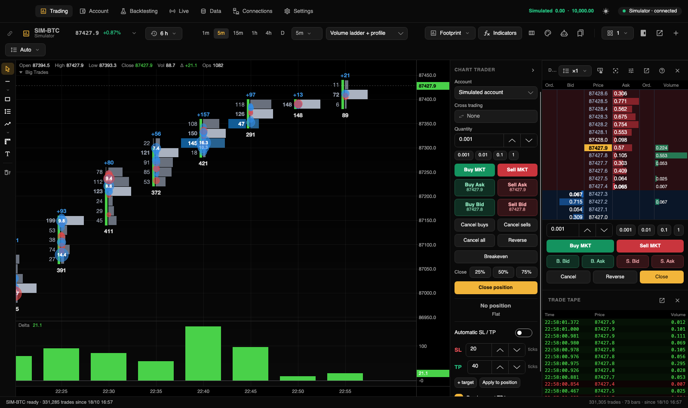
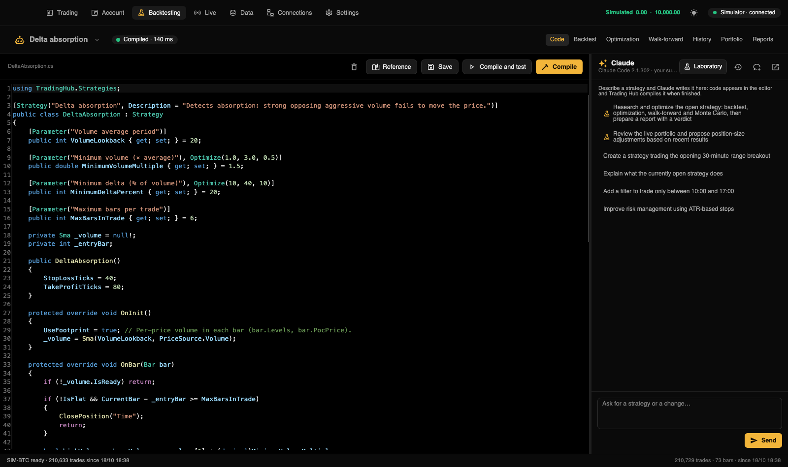
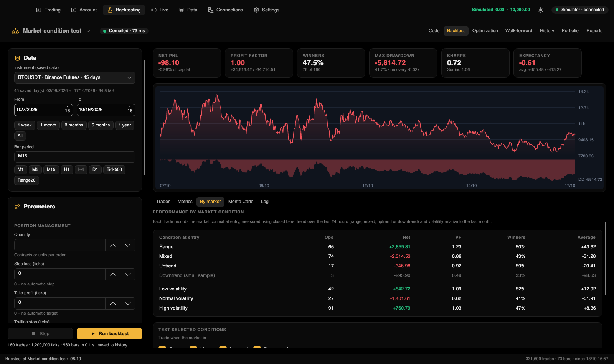
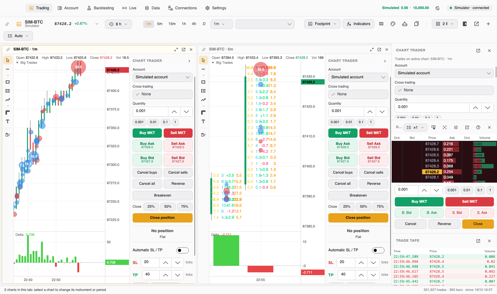

# Trading Hub

**Free, source-available desktop trading platform that runs locally on your Mac.**

Footprint charts, Depth of Market (DOM) trading, professional backtesting designed to reduce overfitting, and AI-assisted strategies. Data and credentials are stored locally; configured providers and optional Claude requests communicate over the network.

Created by [@ralphtradesz](https://x.com/ralphtradesz). English work in this fork reuses [indigiti/TradeDock's community translation](https://github.com/indigiti/tradedock/tree/translation/english-documentation-ui), with additional completion, compatibility fixes and validation.

**English branch:** `feat/english-localization`. Built-in UI, safety dialogs, reports, assistant instructions and full guides are English. Stored identifiers, personal history and third-party content are not destructively rewritten. See the [validation dashboard](docs/en/TRANSLATION_STATUS.md).

**Upstream updates:** [Daily monitoring and the reviewed English sync process](docs/en/upstream-sync.md) track new original-repository commits without automatic merges or deployment.

**Using Windows?** See [Porting Trading Hub to Windows](docs/en/portar-a-windows.md).



## What is Trading Hub?

Trading Hub is a free desktop trading platform whose source code is available to inspect and modify. The application, recorded or downloaded market data, strategies, backtests, and broker credentials are handled locally. On macOS, secrets are stored in Keychain rather than plaintext files. The application does not require a Trading Hub account or its own hosted server, and the project states that it does not collect telemetry.

Supported market connections include:

- **CME futures:** Rithmic, Tradovate, and Databento historical data.
- **Cryptocurrency:** Binance and Bybit, including free public market data.
- **Forex and CFDs:** OANDA, cTrader, and CSV imports.
- **US stocks:** Alpaca.

Claude Code integration uses your own Claude subscription and local CLI, rather than separate API credentials. It can help write, compile, test, and report on C# trading strategies. An additional AI agent assists with live strategy risk allocation.

## Features

### Charts and indicators

- Time, tick, volume, and range bars; candlestick, bar, line, and Heikin Ashi chart styles.
- Configurable **footprint charts**, including bid/ask, delta, volume, Point of Control (POC), and per-bar volume profiles.
- **Depth of Market (DOM)**, trade tape, drawing tools, and chart templates.
- Built-in moving averages, VWAP with standard-deviation bands, Bollinger Bands, RSI, MACD, volume, delta, cumulative volume delta (CVD), session volume profile, and large-trade indicators.
- Custom C# indicators are automatically recompiled when saved; compatibility support is provided for ATAS indicator APIs.
- Replay recorded market sessions at adjustable playback speed.

### Trading

- Chart Trader and DOM with market, limit, and stop orders, bracket orders, targets, and OCO functionality.
- Simulated accounts and live accounts associated with configured broker connections.
- Order history and statistics by account.
- Optional order confirmation for real accounts. Risk limits provide an additional safeguard.

### Market data

- Automatic trade-by-trade recording of observed data, including aggressor side.
- Public Binance and Bybit historical downloads, plus Rithmic and connected-provider history.
- **Databento** historical CME futures tick data billed by usage, with a cost estimate shown before downloading.
- In backtesting, select Rithmic only, Databento only, or combine both sources with Rithmic taking priority.
- CSV imports from Dukascopy, HistData, MetaTrader, and TradingView.

### Strategies and backtesting

- Integrated C# editor using Roslyn compilation and inline compiler errors.
- Strategy API with `EnterLong()`, `StopLossTicks`, indicators, time filters, and market-condition filters.
- Trade-level backtesting that models commissions, slippage, and limit-order fills.
- Bayesian optimization (TPE), intelligent walk-forward optimization, and analysis of stable parameter regions.
- Overfitting diagnostics such as PBO/CSCV, CPCV with embargo, and the Deflated Sharpe Ratio.
- Timeframe optimization from one minute through one day.
- Monte Carlo analysis, market-regime breakdowns, and robustness metrics.

### Live strategies

- Launch strategies from backtesting or charts, with position sizing, daily loss limits, and maximum drawdown limits.
- Compare live results against historical performance.
- Build portfolios and use a Claude-powered risk agent to propose allocations; real-account allocations require user approval.
- Observe real-time market conditions and strategy status through the macOS menu bar.
- Optionally resume strategies when the application opens and prevent the system from sleeping.

### Claude integration

A strategy assistant helps develop and fix C# strategies. A built-in MCP laboratory enables Claude to run backtests, optimization tasks, and walk-forward evaluations and generate detailed reports.

## Screenshots

| | |
|---|---|
|  |  |
| Footprint charts with delta, POC, and large trades | Chart Trader, DOM, and trade tape |
|  |  |
| C# strategies with Claude assistance | Backtesting across market conditions |
|  |  |
| Tick-level history and Databento | Light and dark themes |

## Installation

### Option 1: Install with Claude Code

On an Apple Silicon Mac, open a terminal in the repository folder, start `claude`, and request:

```text
Install Trading Hub on my Mac by following CLAUDE.md.
```

The installation assistant checks prerequisites, installs any missing .NET components without an administrator password, builds the application, and installs it into Applications. The detailed installation instructions are in [INSTALAR_CON_CLAUDE_CODE.md](docs/en/instalar-con-claude-code.md). The full English guides are maintained alongside the retained Spanish originals.

### Option 2: Install manually

Requirements: Apple Silicon Mac, macOS 12 or later, and .NET 10.

```bash
curl -sSL https://dot.net/v1/dotnet-install.sh -o /tmp/dotnet-install.sh
bash /tmp/dotnet-install.sh --channel 10.0
git clone --branch feat/english-localization https://github.com/mehmetcanbudak/trading-hub.git
cd trading-hub
./build-app.sh --install
```

The first build may take several minutes. The application is installed at `/Applications/Trading Hub.app`. It starts with a **simulated trading account**; live trading with real money is not enabled until you configure an appropriate connection.

## Windows support

The current project targets Apple Silicon macOS. Its .NET and Avalonia foundation can also support Windows, but macOS-specific functionality must be adapted. A detailed staged plan is provided in [PORTAR_A_WINDOWS.md](docs/en/portar-a-windows.md) (English guide).

For a 64-bit Windows 10 or 11 computer:

1. Install [Git](https://git-scm.com), [.NET 10 SDK](https://dotnet.microsoft.com/download), and [Claude Code](https://claude.com/claude-code).
2. Clone this repository and open it in a terminal.
3. Ask Claude Code to follow the Windows porting guide, preserving macOS compatibility and executing builds and tests after each stage.
4. Replace Keychain integration with Windows Credential Manager or DPAPI; adapt tray functionality, process launching, keyboard shortcuts, and packaging.
5. Test with a simulated account and public Binance data before considering any real account.

**Windows builds are not claimed to work out of the box.** The port requires implementation and validation.

## Additional indicators

The project provides its own indicators and supports importing custom C# indicators. External ATAS indicators are not bundled because their redistribution rights differ.

To adapt indicators from the [public ATAS indicator repository](https://github.com/AtasPlatform/Indicators):

```bash
git clone https://github.com/AtasPlatform/Indicators.git third_party/ATAS-Indicators
python3 tools/port_atas.py
./build-app.sh --install
```

This script adapts compatible namespaces and handles some compilation differences. Review the upstream license for each imported indicator. Individual C# source files can also be placed in `~/Documents/Trading Hub/Indicadores`; add dependencies when necessary.

## Documentation

Full English guides are available below. Original Spanish sources remain under `docs/` for reference; installation does not rewrite your existing scripts, reports or data.

| Topic | Guide |
|---|---|
| Installation | [Installation and updates](docs/en/instalacion.md) |
| Getting started | [First steps](docs/en/primeros-pasos.md) |
| Connections | [Broker and market-data connections](docs/en/conexiones.md) |
| Charts | [Charts, footprint, DOM, and drawings](docs/en/graficos.md) |
| Trading | [Orders, bracket orders, and accounts](docs/en/operar.md) |
| Data | [Recording, downloading, and CSV imports](docs/en/datos.md) |
| Strategies | [C# strategy API](docs/en/estrategias.md) |
| Backtesting | [Optimization and robustness](docs/en/backtesting.md) |
| Live operation | [Live strategies and risk limits](docs/en/en-vivo.md) |
| Claude | [AI strategy assistant and MCP laboratory](docs/en/asistente-claude.md) |
| Indicators | [Built-in and custom indicators](docs/en/indicadores.md) |
| Settings | [Preferences](docs/en/ajustes.md) |
| Privacy | [Local storage and network access](docs/en/privacidad.md) |
| Development | [Builds, tests, and project structure](docs/en/desarrollo.md) |
| Windows | [Windows porting guide](docs/en/portar-a-windows.md) |

The [original Spanish README](README.es.md) is retained for reference.

## Supporting the project

Trading Hub is available free of charge. If you wish to support the original author's development work, refer to the original [Spanish README's donation instructions](README.es.md#apoyá-el-proyecto). Verify wallet addresses and blockchain networks independently; transfers over the wrong network may be irrecoverable.

## Risk notice

Trading involves substantial risk of financial loss. Trading Hub is a software tool, **not investment advice**. Historical backtests do not guarantee future performance. Use simulated trading before connecting real accounts. The software is supplied without warranty.

## License

The repository contains an **MIT license with the Commons Clause**. You may use, modify, and share the software subject to its license terms, but **commercial sale of the software, modified versions, or paid services primarily based on it is restricted**. Because of this restriction, it should be described as **source-available**, rather than OSI-approved open source.

See [LICENSE](LICENSE) for the authoritative terms.

---

Originally created by [@ralphtradesz](https://x.com/ralphtradesz).
