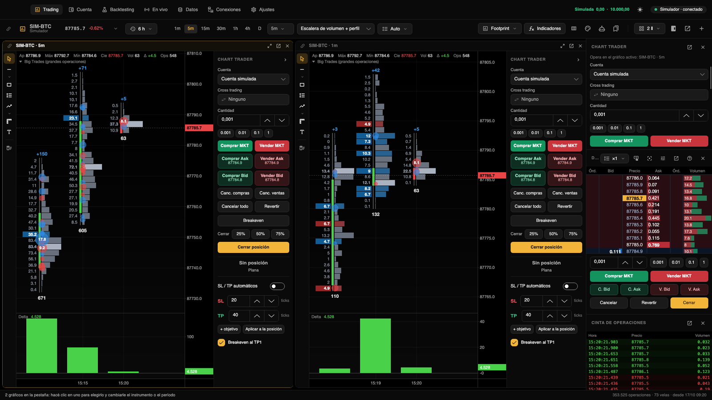
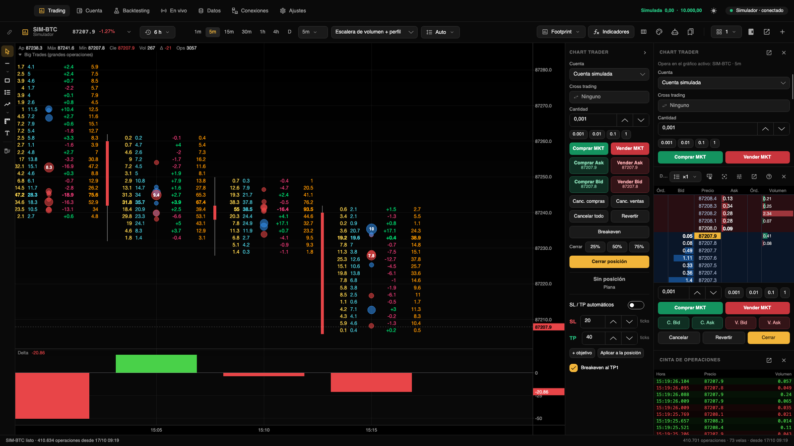
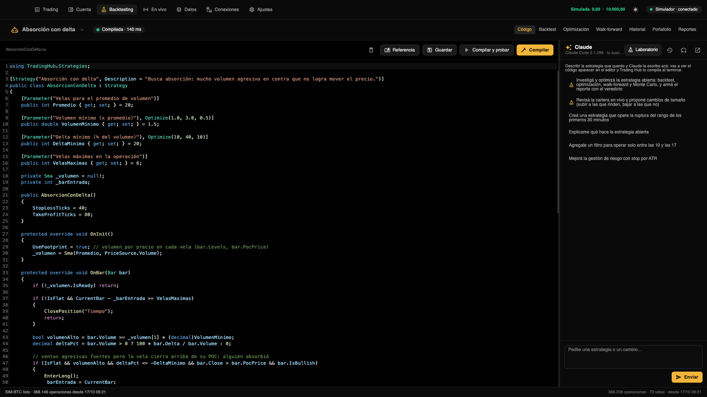
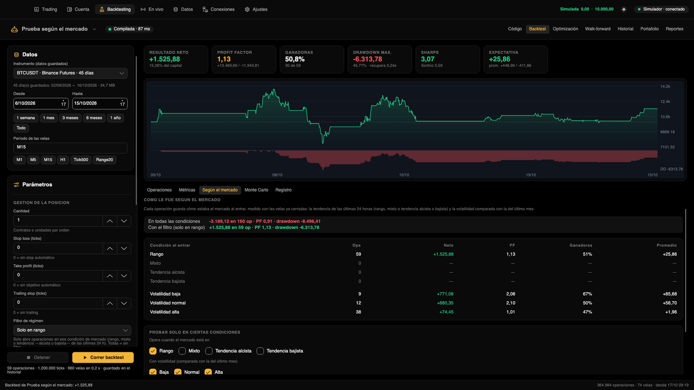
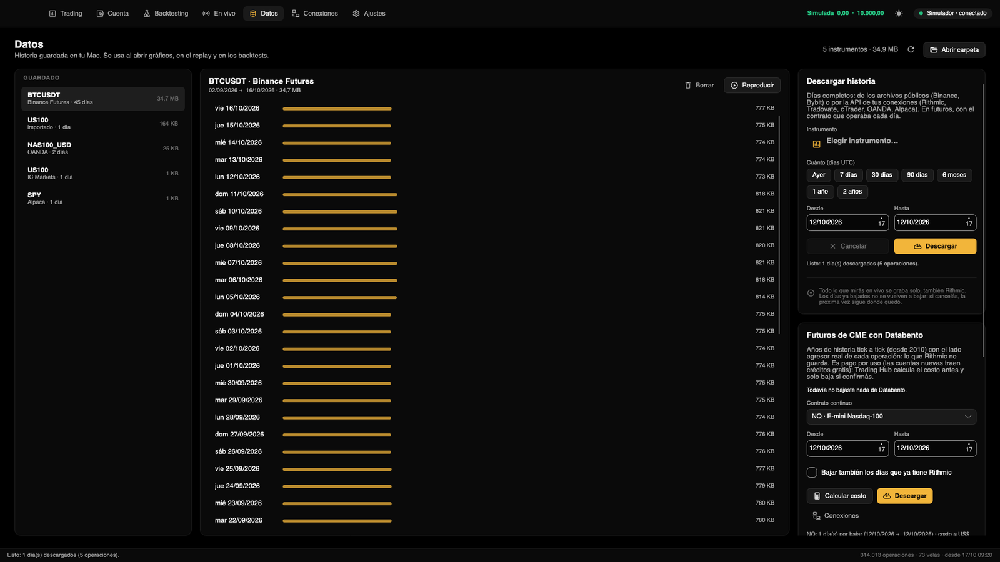
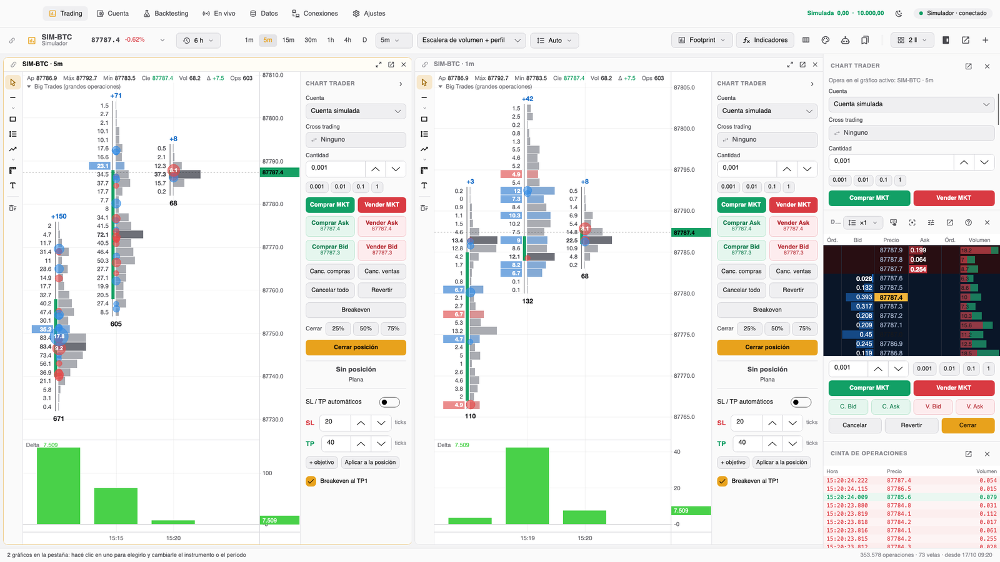

[Español](README.es.md) · [English](README.md) · **中文**

> **KVP 候选集成：**隔离的 `feat/kvp-adoption` 源码分支集成了已批准的完整数据、指标、图表/深度、编辑、练习、提醒、行情商、存储及代理功能，并明确保留数据质量和安全边界。这不代表已安装应用或已发布二进制。请参阅[完整范围与验收记录](docs/en/TRANSLATION_STATUS.md#kvp-capability-adoption-candidate--2026-11-04)和[完整署名及许可证](THIRD_PARTY_NOTICES.md#kvp-capability-reference)。不包含 KVP 品牌/目录迁移、KVP Windows 分发/更新器或仅限 Windows 的外部 VPFM 启动器；未经端到端测量，不宣称 Metal 加速。

<div align="center">

# Trading Hub

**免费、源代码可查看和修改的交易平台，在你的电脑上运行：支持 Mac 和 Windows。**
足迹图、DOM 盘口交易、防过度优化的专业回测和 AI 策略，你的数据和密钥始终留在你的电脑上。

由 [**@ralphtradesz**](https://x.com/ralphtradesz) 创建

使用 Windows？**[下载安装程序](https://github.com/ralphtradesz/trading-hub/releases/latest/download/TradingHub-Setup-x64.exe)**（[安装方法](#使用-windows)）。

使用 Mac（M1 或更新）？可下载**[原始上游应用](https://github.com/ralphtradesz/trading-hub/releases/latest/download/TradingHub-Mac.zip)**，解压后拖到“应用程序”文件夹。确认来源和签名可信后，首次打开时可能需要在 系统设置 → 隐私与安全性 中点击“仍要打开”。此下载不包含本 fork 的额外修正；不要意外替换已安装的 `memoshi`，也不要关闭系统安全检查。

本 fork 暂不发布预编译下载；要使用本 fork，请从 `memoshi` 分支按[手动安装](#手动安装)或[安装指南](docs/en/instalacion.md)编译。

[](LICENSE)




</div>

---
> 本页保留上游功能说明。上游安装程序不一定包含本 fork 独有的安全修正；本 fork 未声称已经发布安装程序。Windows 原生安装/凭据/托盘/电源功能、真实或演示经纪商执行，以及 macOS 物理睡眠/退出流程尚未获得本次集成认证。详见[英文验证状态](docs/en/TRANSLATION_STATUS.md)及[Windows 指南](docs/en/portar-a-windows.md)。下载后请核对来源和签名，不要为不可信文件绕过安全警告。

## 界面语言

在 **设置 → 常规 → 语言** 中选择 English、Español 或简体中文，重新打开应用后生效。已有英文 fork 用户没有 Language 设置时保持英语；新用户按系统语言选择西班牙语、简体中文或默认英语。报告和 Claude 回复使用所选语言，生成的 C#、文件名、标识符及代码注释始终使用英语；不会自动重命名现有代码或持久化目录。**立即重启**先经过持仓保护退出流程；取消退出不会启动第二个进程。


## 简介

Trading Hub 是一款免费、源代码可查看和修改的桌面交易平台。应用、记录或下载的数据、策略和回测都在本地；经纪商密钥保存在 macOS 钥匙串或 Windows 凭据管理器中，不写入普通配置文件。连接的数据提供商及可选 Claude 请求仍需联网。无需 Trading Hub 账户，项目表示不收集遥测。

支持 **CME 期货**（Rithmic、Tradovate 和 Databento 历史数据）、**加密货币**（Binance 和 Bybit，免费数据，无需密钥）、**外汇和 CFD**（OANDA、cTrader 或 CSV 文件）以及**美股**（Alpaca）。

AI 来自**使用你自己订阅的 Claude Code**（无需 API 密钥）：一个助手负责编写 C# 策略、编译、测试并生成报告；一个智能体负责在你的实时策略之间分配风险。

## 功能

### 图表
- 时间、tick、成交量或价格区间 K 线；蜡烛图、美国线、折线或 Heikin Ashi 样式。
- **足迹图**（Footprint）可逐列配置（bid/ask、delta、成交量、POC、每根 K 线的成交量分布），并有专用编辑器。
- DOM 盘口、逐笔成交、绘图工具和模板。
- 内置指标：移动平均线、VWAP（含标准差带）、布林带、RSI、MACD、成交量、delta、累计 delta（CVD）、交易时段成交量分布和大单。你可以用 C# 添加自己的指标（保存时自动重新编译），兼容 ATAS 的指标 API；也可以添加 ATAS 的指标或其他公开源代码的指标：见[更多指标](#更多指标)。
- **回放**任意一个已保存的交易日，速度随你设定。

### 交易
- **Chart Trader** 和 DOM，支持市价单、限价单和止损单、括号单（止损和止盈目标）以及 OCO。
- 内置模拟账户，也可以使用你所连接的实盘账户；每个账户都有历史记录和统计。
- 在模拟账户上，点击即下单，没有任何阻拦；在实盘账户上，你可以要求每笔订单前先确认（可在“设置”中关闭）。安全靠的是风险限制。

### 数据
- 你看过的所有行情都会自动逐笔记录，并标明主动买卖方向。
- 下载：Binance 和 Bybit 的公开数据文件，以及 Rithmic 和你其他连接的历史数据。
- **Databento**：多年的 CME 期货逐笔数据（按量付费，下载前会先显示费用）。数据单独保存，回测时可以选择**仅 Rithmic、仅 Databento 或两者合并**（优先使用 Rithmic，缺的部分由 Databento 补齐）。
- 支持导入来自 Dukascopy、HistData、MetaTrader 或 TradingView 的 CSV。

### 策略与回测
- 用 **C#** 编写策略，内置编辑器毫秒级完成编译（Roslyn，错误直接标在代码上），API 简单：`EnterLong()`、`StopLossTicks`、指标、时段过滤和市场环境过滤。
- 回测基于已保存的每一笔真实成交，计入手续费、滑点，并真实模拟限价单的成交。
- **贝叶斯优化**（TPE）和**智能滚动前推**：选择稳定的参数高原而不是孤立的峰值，压缩 tick 以加快速度，并用 **PBO（CSCV）** 和**带 embargo 的 CPCV** 衡量过度优化。库中还提供**紧缩夏普比率**（Deflated Sharpe）和一套可在代码中调用的完整验证。
- **周期**可以像其他参数一样参与优化（M1 到 D1），**收藏**的策略会排在列表最上方。
- **Monte Carlo**、**按市场状况**划分的结果（震荡、混合或趋势；低、正常或高波动率），以及稳健性指标，避免把运气误当成优势。

### 实时运行
- 可从回测器或图表把策略放到你的账户上运行，并设置最大仓位、单日最大亏损和最大回撤。在图表上能看到它的历史表现：含成本的实际结果、一条迷你曲线和全部统计数据。
- 投资组合、为每个策略建议仓位大小的 **Claude 风控智能体**（实盘账户由你批准）、各市场的实时状况，以及 Mac 菜单栏中的面板。
- 打开时自动恢复运行，以及防睡眠模式（需要的话，合上盖子也能继续运行）。

### Claude
- 一个能编写和修改策略的聊天窗口，以及一个**实验室**（应用自带的 MCP 服务器）：Claude 在里面运行回测、优化和滚动前推，并给你留下一份包含全部指标的专业报告。

## 截图

| | |
|---|---|
|  |  |
| 带 delta、POC 和大单的足迹图 | Chart Trader、DOM 和逐笔成交 |
|  |  |
| 借助 Claude 助手编写 C# 策略 | 按市场状况划分结果的回测 |
|  |  |
| 逐笔历史数据与 Databento | 浅色或深色主题 |

## 安装

### 最简单的方式：用 Claude Code
如果你有 [Claude Code](https://claude.com/claude-code)，在这个文件夹中打开终端，运行 `claude`，然后对它说：

```
按照 CLAUDE.md 在我的 Mac 上安装 Trading Hub。
```

它会检查你的 Mac，安装缺少的组件（无需管理员密码），编译应用并放进“应用程序”文件夹。本分支的步骤见[安装说明](docs/en/instalacion.md)。[原作者的西班牙语指南](INSTALAR_CON_CLAUDE_CODE.md)保留作历史参考，不是本分支的安装步骤。

### 手动安装
你需要一台 Apple Silicon 的 Mac，系统为 macOS 12 或更新版本（Windows 请看[使用 Windows？](#使用-windows)）。

```bash
curl -sSL https://dot.net/v1/dotnet-install.sh -o /tmp/dotnet-install.sh
bash /tmp/dotnet-install.sh --channel 10.0
git clone --branch memoshi https://github.com/mehmetcanbudak/trading-hub.git
cd trading-hub
./build-app.sh --install
```

第一次编译需要几分钟。应用会安装在 `/Applications/Trading Hub.app`，启动时使用模拟账户：在你于“连接”中开启之前，不会动用真实资金交易。详见[本分支安装说明](docs/en/instalacion.md)。

## 使用 Windows？

本分支支持从源码构建 Windows x64/ARM64 和每用户安装程序，但尚未发布本分支安装包，也未完成原生 Windows 验证。请按 [Windows 安装说明](docs/en/portar-a-windows.md)构建、安装和更新。

[原作者的 Windows 安装包](https://github.com/ralphtradesz/trading-hub/releases/latest)属于上游版本，不代表包含本分支的功能或安全修复。不要将其当作 `memoshi` 的发行版。

数据保存在 `%APPDATA%\Trading Hub`，策略和指标在 `文档\Trading Hub`，密钥在 **Windows 凭据管理器**中。更新和卸载应保留这些用户数据。

如果想编译本 fork：需要 [Git](https://git-scm.com)、[.NET 10 SDK](https://dotnet.microsoft.com/download) 和 [NSIS](https://nsis.sourceforge.io)（`winget install NSIS.NSIS`），然后在本 fork 仓库运行 `.\build-windows.ps1`（安装程序生成在 `dist` 中）。在 Mac 上：`brew install makensis`，再运行 `./build-windows.sh`。详见[英文 Windows 指南](docs/en/portar-a-windows.md)。安装位置默认为 `%LOCALAPPDATA%\Programs\Trading Hub`；数据目录和 `Estrategias`、`Indicadores`、`Reportes` 等持久化名称不随语言变化。

## 更多指标

Trading Hub 自带一套指标（均线、VWAP、布林带、RSI、MACD、成交量、delta、CVD、成交量分布和大单）。其他平台的指标不在仓库中，因为它们的代码没有允许再分发的许可证，但你可以从它们的公开源代码**自行添加**：

**一次性添加全部 ATAS 指标**（约 250 个，来自其公开仓库 [AtasPlatform/Indicators](https://github.com/AtasPlatform/Indicators)）：

```bash
git clone https://github.com/AtasPlatform/Indicators.git third_party/ATAS-Indicators
python3 tools/port_atas.py
./build-app.sh --install
```

脚本会把 ATAS 的命名空间改成 Trading Hub 的，不改动逻辑（另外修正几处细节以便能够编译），之后它们会和其他指标一起出现在指标库中。ATAS 发布更新时，运行 `git -C third_party/ATAS-Indicators pull`，再重复最后两步即可。生成的两个文件夹都在 `.gitignore` 中，所以你 fork 之后也不会被推送上去。

**单个指标，来自 ATAS 或任何其他公开的 C# 源代码**：把 `.cs` 文件复制到 `~/Documents/Trading Hub/Indicadores`。Trading Hub 会自动编译它、适配 ATAS 的命名空间，并把它加入指标库。如果它用到了另一个指标（例如 ATAS 的 CCI 用到了它的 SMA），把那个也一起复制过去。

这些指标归各自的作者所有：使用时请遵守每个来源的许可证。详见 [docs/indicadores.md](docs/indicadores.md)。

## 文档（西班牙语）

| | |
|---|---|
| [安装](docs/instalacion.md) | 系统要求、编译、更新和卸载 |
| [入门](docs/primeros-pasos.md) | 应用导览 |
| [连接](docs/conexiones.md) | 经纪商、交易所和数据；实盘账户和模拟账户 |
| [图表](docs/graficos.md) | 周期、足迹图、DOM、绘图、指标和回放 |
| [交易](docs/operar.md) | Chart Trader、DOM、订单、括号单和账户 |
| [数据](docs/datos.md) | 数据记录、下载、Databento 和 CSV 导入 |
| [策略](docs/estrategias.md) | C# API 及示例 |
| [回测](docs/backtesting.md) | 回测、优化、滚动前推、PBO、CPCV 和 Monte Carlo |
| [实时运行](docs/en-vivo.md) | 在你的账户上运行策略、投资组合和风控智能体 |
| [Claude](docs/asistente-claude.md) | 策略助手和 MCP 实验室 |
| [指标](docs/indicadores.md) | 内置指标、自定义指标，以及与 ATAS API 的兼容 |
| [设置](docs/ajustes.md) | 全部选项 |
| [隐私](docs/privacidad.md) | 哪些内容留在你的 Mac 上，哪些会连接互联网 |
| [开发](docs/desarrollo.md) | 代码结构、测试和场景 |
| [Windows](PORTAR_A_WINDOWS.md) | 哪些部分依赖具体的操作系统，以及 Windows 版本是怎么做出来的 |

## 支持这个项目

Trading Hub 是免费的，以后也会一直免费。如果它对你有用，你也想支持它的开发，可以在这里捐赠：

| 币种 | 网络 | 地址 |
|---|---|---|
| USDT | BEP20 (BNB Smart Chain) | `0xebedab9a1f6820914b0869e4126d5c54aa028a2a` |
| USDT | TRC20 (Tron) | `THAULimtnWpbQ8opZWxK8863nZEkyek4E5` |
| BTC | BEP20 (BNB Smart Chain) | `0xebedab9a1f6820914b0869e4126d5c54aa028a2a` |

每种币请**只通过表中对应的网络**发送：通过其他网络发送的币会丢失。谢谢！

## 免责声明

在市场中交易有亏钱的风险。Trading Hub 是一个工具：它不提供投资建议，回测结果也不能保证未来的结果。请务必先用模拟账户测试。本软件按“原样”提供，不附带任何担保（见[许可证](LICENSE)）。

## 许可证

[MIT 加 Commons Clause 条款](LICENSE)：你可以免费使用 Trading Hub（包括用自己的钱交易）、修改和分享它，但必须保留许可证声明。你不能做的是**出售它**：无论是应用本身、修改后的版本，还是价值来自 Trading Hub 的付费服务（例如收费帮人安装、托管或提供技术支持）。由于这一条件，它不是 OSI 严格意义上的“开源”许可证：代码公开且免费，但不能用于商业销售。

从其他平台移植过来、没有开放许可证的指标不属于本仓库，但你可以从它们的公开源代码自行添加（见[更多指标](#更多指标)）。

---

<div align="center">

由 [**@ralphtradesz**](https://x.com/ralphtradesz) 用心打造

</div>
