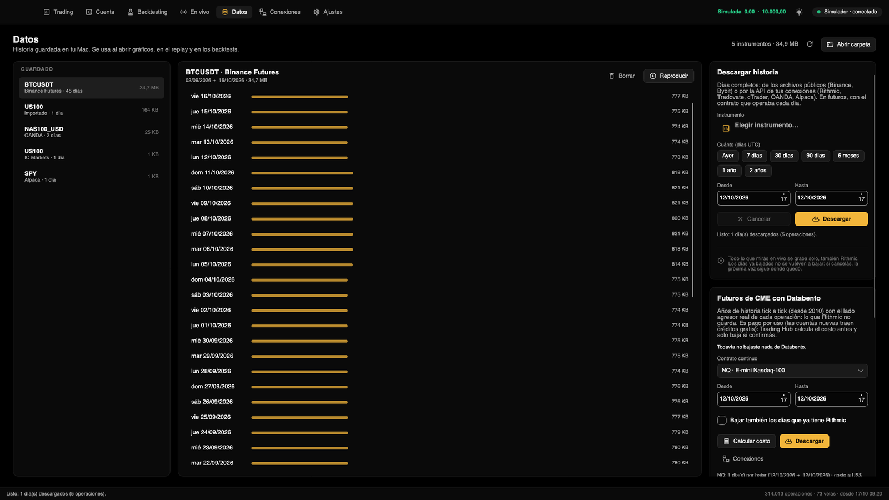

[← Volver al índice](./README.md)

# Datos

La sección **Datos** (⌘3) muestra la historia guardada en tu Mac. Esa historia se usa al abrir gráficos (carga al
instante), en el replay y en los backtests.

La pantalla tiene tres partes: a la izquierda, **Guardado** (los instrumentos que tenés); en el medio, los **días** del
instrumento elegido; a la derecha, **Descargar historia**, **Futuros de CME con Databento** e **Importar archivos**.
Arriba se ve el total («N instrumentos · tamaño»), un botón para actualizar la lista y **Abrir carpeta**.

## De dónde sale la historia

- **Lo que mirás en vivo se graba solo**, también lo de Rithmic. Se controla en **Ajustes → Datos → Grabar lo que
  llega en vivo** (viene activado).
- **Descargas** de días completos, desde archivos públicos o desde la API de tus conexiones.
- **Archivos importados** (CSV o TXT) de CFDs, forex y otros mercados.
- **Databento**, para años de futuros de CME.

Todo queda como operaciones, en un archivo por conexión, instrumento y día (UTC).

## Lo guardado

En **Guardado** cada instrumento muestra su conexión, cuántos días tiene y cuánto ocupa. Al elegir uno, en el medio
aparecen sus días, del más nuevo al más viejo, con una barra proporcional al tamaño (más o menos, la cantidad de
operaciones) y lo que ocupa cada día. Arriba se ve el rango completo («dd/MM/aaaa → dd/MM/aaaa») y el tamaño total.

Para elegir varios días, usá ⌘ o ⇧ al hacer clic.

### Borrar días

1. Elegí el instrumento en **Guardado**.
2. Seleccioná uno o más días.
3. Tocá **Borrar** y confirmá. Se borran esos días de ese instrumento y no se puede deshacer.

## Replay

El replay reproduce días guardados como si fueran en vivo y te deja operar con la cuenta simulada.

1. Elegí el instrumento y un día. Si elegís varios, se reproduce desde el primero hasta el último.
2. Tocá **Reproducir** (o hacé doble clic en un día).
3. Se abre una pestaña nueva en Trading, marcada con ▶, que arranca en la primera operación del primer día elegido y
   termina al final del último. Usa el período del gráfico activo y copia sus indicadores; la historia anterior al
   inicio se carga de los mismos archivos.

Abajo aparece la barra de replay:

| Control | Qué hace |
|---|---|
| Play / pausa | Arranca o frena la reproducción. |
| 1× a 300× | Velocidad: 1×, 2×, 5×, 10×, 30×, 60× o 300× el tiempo real. |
| Reloj y progreso | El instante que se está reproduciendo; «Terminado» al llegar al final. |
| +5 min, +30 min, +1 h | Saltan hacia adelante. |

Los dibujos que hagas en un replay no se guardan, y el replay no queda en el espacio de trabajo. Las operaciones que
hagas sí van al historial de la cuenta simulada.

## Descargar historia

Baja días completos de un instrumento.

1. En **Instrumento**, elegí el instrumento (si el gráfico activo se puede descargar, ya viene propuesto).
2. En **Cuánto (días UTC)**, tocá un atajo (Ayer, 7 días, 30 días, 90 días, 6 meses, 1 año o 2 años) o cambiá
   **Desde** y **Hasta**. El día de hoy no se baja porque todavía no terminó.
3. Leé el resumen debajo de los botones: cuántos días son y de dónde salen.
4. Tocá **Descargar**. Se ve el día que está bajando, el progreso y cuánto falta. **Cancelar** frena la descarga.

| Fuente | Qué se baja |
|---|---|
| Binance Futures y Spot | Archivos diarios públicos de Binance, sin cuenta. |
| Bybit | Archivos diarios públicos de Bybit, sin cuenta. |
| Rithmic | Tick a tick, con el contrato que operaba cada día (por ejemplo ESU6 y después ESZ6). Rithmic guarda solo desde el último vencimiento: no da la historia de los contratos vencidos. |
| Tradovate | Ticks de Tradovate (hacen falta los datos de CME habilitados para API). |
| cTrader | Los ticks (bid) del broker por la Open API. |
| OANDA | Velas de 5 segundos convertidas en operaciones (los CFDs no tienen operaciones reales). |
| Alpaca | Operaciones de todas las bolsas de EE.UU. (SIP), gratis desde 2016. |

- Los días que ya están completos no se vuelven a bajar: si cancelás, la próxima vez sigue donde quedó.
- Por las APIs (Rithmic, Tradovate, cTrader, OANDA y Alpaca) los sábados no se piden, y el día bajado reemplaza lo que
  se había grabado en vivo.
- Un índice como el ES tiene más de un millón de operaciones por día: un rango largo tarda.
- Si un día no trae nada, el resumen final lo cuenta aparte (feriados, fines de semana o archivos todavía no
  publicados). Si Rithmic no devuelve un contrato vencido, también lo avisa.
- Las conexiones que no dan historia para bajar graban sus datos cuando las mirás en vivo.

## Importar archivos

Para CFDs (US100, US500, DAX), forex, oro y otros mercados que no tenés por una conexión. Bajás el CSV de Dukascopy o
HistData, o lo exportás de MetaTrader o TradingView, y Trading Hub lo convierte en historia para gráficos, replay y
backtests. El formato se reconoce solo: ticks con bid y ask, velas, o cualquier CSV con fecha y precio u OHLC.

1. Bajá los archivos. Los botones **Dukascopy** e **HistData** abren sus páginas de descarga.
2. En **Nombre del instrumento**, escribí el símbolo o dejalo vacío para que se deduzca del nombre del archivo.
3. En **Hora del archivo**, elegí la zona horaria con que viene:

   | Opción | Para |
   |---|---|
   | UTC | Dukascopy y TradingView |
   | Nueva York fija, −5 | HistData |
   | UTC+2 | MetaTrader en invierno |
   | UTC+3 | MetaTrader en verano |

4. Tocá **Importar archivos…** y elegí uno o varios archivos CSV o TXT.
5. Al terminar, el resumen dice cuántas operaciones y días se importaron, el rango y el paso de precio detectado. El
   instrumento aparece en **Guardado** con la conexión «importado» y en los backtests.

El nombre se deduce así: USATECH, NAS100, NSX, US100, USTEC o NDX → US100; USA500, SPX o US500 → US500; USA30, US30,
DJI o WS30 → US30; DEU, GER o DAX → GER40; XAU o GOLD → XAUUSD; y los pares EURUSD, GBPUSD, USDJPY, AUDUSD, USDCAD,
USDCHF, NZDUSD, XAGUSD y BTCUSD por su nombre. Si no reconoce nada, usa la primera palabra del archivo.

Los CFDs no tienen volumen real: cada cotización cuenta como una operación (volumen de ticks) y el lado sale de si el
precio subió o bajó. Sirve para precio, velas y backtests de precio; el footprint y el delta son aproximados. Las velas
se convierten en operaciones sintéticas.

## Databento

Databento vende la historia tick a tick de los futuros de CME desde 2010, con el lado agresor real de cada operación:
lo que Rithmic no guarda. Es pago por uso (las cuentas nuevas traen créditos gratis), así que Trading Hub siempre
calcula el costo antes y solo baja si confirmás.

Antes, agregá la conexión **Databento** con tu API key en [Conexiones](./conexiones.md#databento). El botón
**Conexiones** de la tarjeta te lleva ahí.

1. En **Contrato continuo**, elegí el mercado: NQ, ES, MNQ, MES, YM, RTY, CL, GC, MCL, MGC, ZN o 6E. Se usa el
   contrato continuo por volumen, que rola como los gráficos.
2. Elegí **Desde** y **Hasta** (de entrada, los últimos tres meses).
3. Elegí si tildás **Bajar también los días que ya tiene Rithmic**:
   - **sin tildar** (más barato): se saltean los días que Rithmic ya tiene completos, y Databento solo completa los
     que faltan;
   - **tildada**: baja todo el rango, para tener la historia de Databento entera.
4. Tocá **Calcular costo**. Te dice cuántos días hay por bajar, el rango y el costo aproximado en dólares de tus
   créditos.
5. Tocá **Descargar** y confirmá en la ventana «Bajar historia de Databento». Si los créditos no alcanzan, Databento
   cobra la diferencia a tu medio de pago en Databento.

**Descargar** se habilita recién después de calcular el costo. Si cambiás el mercado, las fechas o la casilla, hay que
volver a calcularlo. Los días que ya tenés de Databento no se vuelven a bajar ni se cobran, los sábados se saltean y
el rango llega hasta ayer. Los días sin operaciones (feriados) se cuentan aparte. **Cancelar** frena la descarga y lo
bajado queda guardado.

En la misma tarjeta se ve lo que ya bajaste («Ya tenés de Databento: …», con los días y el rango de cada mercado).

### Se guarda aparte

Lo de Databento queda separado, como «Databento» en la lista **Guardado**, sin mezclarse con lo que grabó o bajó
Rithmic. En **Backtesting**, en «Instrumento (datos guardados)», un futuro que tiene historia de las dos fuentes
aparece tres veces (cada opción termina con la cantidad de días):

| Opción | Qué usa |
|---|---|
| NQ · Rithmic + Databento | Las dos combinadas: manda Rithmic, y Databento completa los minutos en que Rithmic no tiene ninguna operación (por ejemplo, las horas en que la app estuvo cerrada y no grabó). |
| NQ · solo Rithmic | Solo lo de Rithmic. |
| NQ · Databento | Solo lo de Databento. |

Con Tradovate pasa lo mismo: «Tradovate + Databento», «solo Tradovate» y «Databento». Al elegir la combinada, el
resumen del backtest dice cuántos días aporta cada fuente.

## Dónde quedan los archivos

La historia vive en `~/Library/Application Support/Trading Hub/Ticks`, en una carpeta por conexión («rithmic»,
«databento», «importado»…) y otra por instrumento, con un archivo por día. **Abrir carpeta** la muestra en el Finder.
Ver también [Instalación](./instalacion.md#dónde-guarda-tus-datos).
