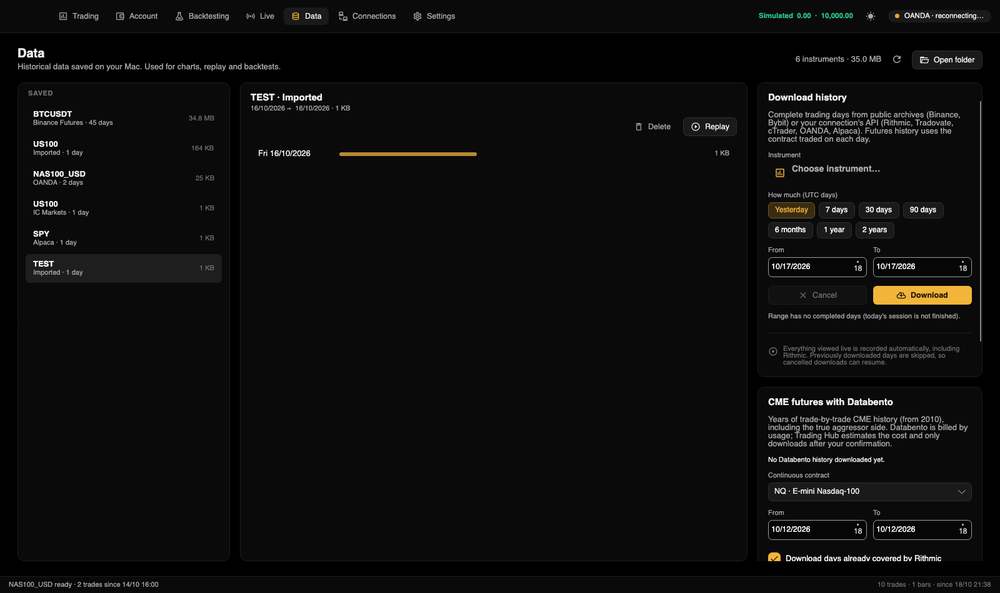

[← Documentation index](README.md)

# Data

**Data** (⌘3) manages local history used by charts, replay and backtests. The left column lists **Stored** instruments, the middle their days, and the right offers history downloads, Databento and file import. The header shows instrument count/size, Refresh and Open folder.

## Sources of history

- Incoming live data records automatically, including Rithmic, when **Settings → Data → Record incoming live data** is enabled (default).
- Complete-day public archive/API downloads.
- Imported CSV/TXT files.
- Long-range CME futures history from Databento.

Trade files are organized by connection, instrument and UTC day. Synthetic quote/bar data must not be mistaken for actual exchange executions.

## Stored history

An instrument shows connection, day count and disk usage. Selecting it lists days newest-first with size-proportional bars and the complete date range/size. Use ⌘/⇧-click for multiple days.

### Delete days

Select an instrument and days, choose **Delete** and confirm. Only those days are removed, but **deletion cannot be undone**. Do not delete data being recorded or needed by running strategies.

## Replay

1. Select an instrument and one or more stored days.
2. Choose **Replay**, or double-click a day.
3. A new ▶ tab starts at the first selected day's first trade and runs to the last day's end. It copies the active chart's period/indicators and loads earlier history from the same local files.

| Control | Action |
|---|---|
| Play / Pause | Start / pause replay. |
| Speed | 1×, 2×, 5×, 10×, 30×, 60× or 300× real time. |
| Clock / progress | Current replay timestamp; Completed at the end. |
| +5 min / +30 min / +1 h | Skip forward. |

Replay drawings are not persisted and replay tabs are not restored with the workspace. Simulated orders **are** recorded in simulated-account history.

## Download history

1. Select an instrument; a downloadable active-chart instrument is proposed automatically.
2. Under the UTC-day range choose Yesterday, 7/30/90 days, 6 months, 1/2 years, or enter From/To. Today is excluded because it is incomplete.
3. Review day count and source.
4. **Download** shows current day, progress and remaining work. **Cancel** stops it.

| Provider | Download |
|---|---|
| Binance Futures / Spot | Public daily archives without credentials. |
| Bybit | Public daily archives without credentials. |
| Rithmic | Trades for each day's actual contract. Expired-contract history is limited by provider retention. |
| Tradovate | Ticks subject to CME API-data entitlement. |
| cTrader | Broker bid quotes from Open API. |
| OANDA | Five-second bars converted to synthetic trades. |
| Alpaca | Consolidated SIP stock trades, subject to entitlement/delay. |

- Complete days are skipped, so canceled downloads can resume.
- API downloads skip Saturdays. A successfully downloaded day replaces that day's live-recorded file.
- ES can exceed a million trades daily; long ranges take time and space.
- Empty holidays/weekends/unpublished days are counted separately. Missing expired Rithmic contracts are reported.
- Sources without download support can still record the live data you view.

## Import files

Import Dukascopy/HistData or MetaTrader/TradingView exports for index CFDs, forex, gold and other markets. Formats are detected automatically: bid/ask ticks, bars, or date/price/OHLC CSV.

1. Obtain files; Dukascopy/HistData buttons open their download pages.
2. Enter a symbol or leave it blank for filename inference.
3. Choose the file's time convention:

   | Setting | Typical source |
   |---|---|
   | UTC | Dukascopy / TradingView. |
   | Fixed New York, UTC−5 | HistData. |
   | UTC+2 | MetaTrader winter. |
   | UTC+3 | MetaTrader summer. |

   These are fixed offsets, not an automatic daylight-saving conversion; verify the file's actual convention.
4. Choose one or more CSV/TXT files using **Import files**.
5. Review imported trades/days, range and inferred tick size. The instrument appears under imported history and in Backtesting. The stored feed ID remains `importado` for compatibility.

Filename inference: USATECH/NAS100/NSX/US100/USTEC/NDX → US100; USA500/SPX/US500 → US500; USA30/US30/DJI/WS30 → US30; DEU/GER/DAX → GER40; XAU/GOLD → XAUUSD. EURUSD, GBPUSD, USDJPY, AUDUSD, USDCAD, USDCHF, NZDUSD, XAGUSD and BTCUSD retain their pair names. Otherwise the first filename word is used; if that is empty, the legacy ticker `IMPORTADO` is retained so existing imports do not split across renamed identities.

CFDs do not have centralized exchange volume. Quotes become unit-volume ticks with an inferred side; bars become synthetic trades. Suitable for price charts and price-based backtests, **not authoritative footprint/delta analysis**.

## Databento

Databento supplies paid historical CME ticks, including aggressor side, beyond Rithmic's retained range. Signup credits, availability and prices vary. The app estimates cost and requires confirmation before downloading.

Add a Databento API key in [Connections](conexiones.md#databento), or use the card's Connections button.

1. Choose a volume-based continuous contract: NQ, ES, MNQ, MES, YM, RTY, CL, GC, MCL, MGC, ZN or 6E.
2. Choose From/To; the default is approximately three months.
3. **Also download days already available from Rithmic**:
   - Off: skip complete Rithmic days and fill missing history, reducing cost.
   - On: download the entire requested Databento range.
4. **Calculate cost** shows pending days, range and estimated US-dollar usage.
5. **Download** opens a paid-download confirmation whose default is **Cancel**: Enter cancels; confirm with a click or ⌘Enter. **Usage beyond available credits can be charged to the payment method on your Databento account.**

Download is enabled only after estimating cost. Changing market, dates or the checkbox invalidates the estimate. Existing complete Databento days are skipped rather than charged again; Saturdays and today are excluded. Empty days are counted separately. Cancel retains completed files; provider charges already incurred are not undone.

The card also summarizes locally available Databento markets, days and date ranges.

### Separate storage

Databento files stay separate from Rithmic files. In Backtesting, a futures instrument with both sources has:

| Choice | Used data |
|---|---|
| Rithmic + Databento | Rithmic takes priority; Databento supplies minutes with no Rithmic trades. |
| Only Rithmic | Rithmic alone. |
| Databento | Databento alone. |

The same applies to Tradovate + Databento / Only Tradovate / Databento. Combined-data summaries show each provider's contributed days. Combining is performed when reading; original files remain separate.

## File locations

History is under `~/Library/Application Support/Trading Hub/Ticks`, then connection (`rithmic`, `databento`, `importado`, etc.), instrument and day. **Open folder** opens Finder. See [Storage](instalacion.md#where-your-data-lives).

Compatibility headers and feed IDs are intentionally retained, including recognized Spanish CSV column aliases and the historical live-trade CSV export column names. Translating identifiers would break existing consumers; new report prose and UI are English.
