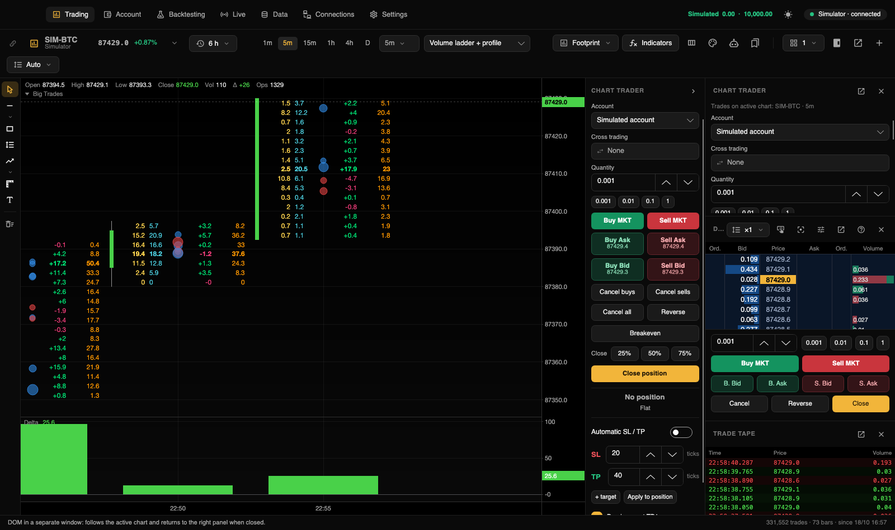

[← Documentation index](./README.md)

# Charts

Charts live in **Trading** (⌘1). Each has drawing tools on the left and its own Chart Trader on the right. The top toolbar controls the active chart, meaning the last chart clicked.

## Chart toolbar

The toolbar is one row of groups: instrument · periods and history · chart style and footprint controls · analysis.

| Control | Action |
|---|---|
| Link color | Join a color group; see [Linked charts](#link-charts-by-color). |
| Instrument (⌘K) | Symbol, price and session change; click to select another instrument. |
| Periods / History | Favorite periods, the full period selector (the arrow) and how much history to load. |
| Chart style | Candles, Bars, Line, Heikin Ashi or Footprint; footprint adds its template and ticks-per-row controls. |
| Indicators | Open indicator settings (⌘I); the badge shows how many indicators the chart has. |
| ★ | Favorite indicators (one click adds one) and chart templates. In **Indicators**, right-click a library item → **Add to favorites**. |
| View | Navigation, rectangle zoom, reset, clock/time zone and shortcuts; the clock follows it. |
| ▶ | Practice replay. |
| Robot / palette | Chart strategies and chart settings. |
| Camera / full screen | Save a PNG of the chart (double resolution) in **Pictures/Trading Hub**; toggle full screen for the chart's window. |
| Layout | Number and arrangement of charts in this tab. |
| Panels | Show/hide the right panel, Chart Trader, DOM and tape; open DOM settings. |
| Detach / **+** | Detach the chart (⇧⌘D) or create a tab (⌘T). |

In narrower windows the toolbar stays one row: button labels become icons; below about 1,380 pixels the pinned periods fold into the period selector, and the clock, toolbar link color, screenshot and full-screen buttons are hidden (each chart header keeps its own link control). Only an extremely narrow window wraps a whole group to a second row, never cutting buttons.

## Instrument and history

The instrument selector searches enabled connections and displays symbol, description, price, 24-hour change and volume. Enter opens the active chart; ⌘Enter creates a tab; the star marks a favorite.

When a nonempty query has no matches in the current non-favorites profile, the selector can offer results from other enabled market-data profiles. Incomplete provider searches remain visibly incomplete. Switching the browse profile does not choose an instrument or change the trading account: an explicit picked result/Enter is still required. Favorites and an empty query do not trigger this fallback.

History ranges run from 30 minutes to five years, plus **All history** and **From a date**. Recent history uses individual trades and supports footprint. Older provider history uses one-minute bars, or five-/15-minute bars for ranges over 400 days; synthetic trades derived from these bars do **not** provide true footprint information. Tick history downloaded through [Data](./datos.md) remains tick-level. The status bar indicates where footprint-capable history begins.

When the chart itself has focus, committed text opens **Chart symbol / period**. A bare number can be either an exact numeric symbol or a minute period; both are separate visible choices. Choose the data connection explicitly, use arrows to select a visible result and Enter to apply it. A prefix without a selected row is not an implicit order or instrument selection. Escape cancels; `?` opens shortcut help. IME preedit is not committed chart text. Old asynchronous results are discarded after query, tab, focus, model, connection or window changes.

Quick-entry data navigation retains the selected account identity. If the account is incompatible with the new source, it is visibly **unavailable**, with no fallback order route, until a compatible account is explicitly selected. A composite crypto source has no executable account, including the shared simulator. Practice keeps its run-owned instrument/account; open a separate normal chart to choose another symbol. Existing order hotkeys and their confirmations are not changed by chart entry.

## Data and recording status

A small **Data warning** or **Not recording** badge keeps diagnostics out of the chart center. Hover or click the badge for the full current message, or navigate to the chart with the keyboard. **Escape** closes details, not the underlying condition; a new hover can open them again. Badge clicks do not start chart or order gestures. Ordinary chart clicks do not automatically open a large warning.

**“The bounded raw window is full”** means the chart reached its in-memory raw-trade limit, not that macOS ran out of storage. Additional coverage uses explicitly labelled candle history **when the provider has it**. Candle-derived or compact history does not become raw ticks or acquire missing footprint/aggressor detail.

**Not recording** means live data can remain readable while new ticks are not being saved. Read the complete cause—for example, another writer owns the history files or storage is unavailable—rather than deleting history or assuming recording continued. Recovery clears the obsolete disclosure automatically. The same controls work in detached chart windows.

## Periods

The defaults are 1m, 5m, 15m, 1h, 4h and D. The selector includes:

| Group | Periods |
|---|---|
| Seconds | 5s, 10s, 15s, 30s. |
| Minutes | 1m, 2m, 3m, 5m, 10m, 15m, 30m. |
| Hours | 1h, 2h, 4h, 6h, 12h. |
| Days | D, W and Month. |
| Ticks | 100, 250, 500 and 1000 trades per bar. |
| Volume | Vol 100, 500 and 1000 units per bar. |
| Range and others | Range 10/20 ticks, Delta 50/100 (close when absolute delta reaches the threshold), Renko 10. |

- **Right-click** a selector period to add/remove its toolbar favorite. Favorites are highlighted.
- **Custom:** enter a code and press Enter, for example `M3`, `H2`, `S20`, `Tick500`, `Volume100`, `Range20`, `Delta75` or `Renko5`.

## Chart styles

Choose **Candles**, **Bars**, **Line**, **Heikin Ashi** or **Footprint**. Switching to footprint increases bar width to make room for numbers.

## Footprint

Footprint adds two controls:

- **Template:** Bid x Ask (classic), Volume ladder + profile, Delta ladder + volume profile, Double ladder (bid | ask), Double delta ladder, Volume (cells), Delta (cells), Bid / ask histogram, Per-bar volume profile and Bid x Ask + profile. User templates have a leading star. **Edit columns** opens the editor.
- **Ticks per row:** Auto, which adapts to zoom, or 1–1000 ticks.

### Footprint editor

Open with ⇧⌘F, **Edit columns** in the footprint template selector or **Right-click → Edit footprint**. Changes appear immediately.

1. Choose a starting template.
2. Add left-to-right **Ladder**, **Profile**, **Cells**, **Spacer** or **Bar** columns. Arrows reorder and the trash button removes them.
3. Select a column and configure:
   - type: thin candle, colored cells, numerical ladder, histogram profile or spacer;
   - data: volume, delta, bid/aggressive selling, ask/aggressive buying, bid × ask or trade count;
   - relative width, profile direction, strong-delta/diagonal-imbalance/bar-POC/high-volume highlighting, volume/delta/bid-ask/heat-map/solid/no-background coloring, text alignment and numbers over bars;
   - per-column background and text colors; Automatic uses theme defaults.
4. General options include bar totals, POC boxes, imbalance marks, imbalance ratio and minimum volume (default ratio 3), strong-delta threshold, highlight minimum volume and scaling colors per bar versus all visible data.
5. Name and **Save as template** to reuse the layout.

## Navigate a chart

| Gesture | Result |
|---|---|
| Wheel | Horizontal zoom around the pointer. With **Chart settings → Axes → Wheel zooms the whole chart** the price range zooms by the same proportion around the pointer, like an image (off by default). |
| ⇧ + wheel / horizontal gesture | Pan through time. |
| Wheel on price axis / ⌘ + wheel | Vertical zoom. |
| + / − keys | Zoom around the chart center with the same rule as the wheel. |
| ⇧ + drag on empty space | Measure like the ruler without saving a drawing; the next click clears it. |
| Drag price axis / double-click | Change scale / restore automatic scale. |
| Drag time axis / double-click | Change bar width / return to latest data. |
| Lower-right return button | Appears after scrolling back; returns to latest data. |

See [First steps](./primeros-pasos.md#keyboard-shortcuts) for keys. **Chart → Auto scale** is ⌥⌘A; **Latest price** is ⌘End. Zoom always stays inside the bar-width bounds; when the bar width reaches its limit, whole-chart zoom stops scaling price too.

The selected deep-zoom path permits a minimum width of 0.1 pixel per candle. Dense rendering reduces visible candles into per-pixel OHLC/close-extrema geometry; the final visible candle supplies the deliberate color policy, not the aggregate bucket's net direction. This is rendering only: analytic bars, strategy inputs and stored history are not downsampled. Normal pointer-focal zoom, live-edge behavior and time panning remain in effect. The actual 50,000-candle scene passed in the unmerged fixture worktree; it does not certify every GPU/native host (see [dashboard](./TRANSLATION_STATUS.md#unmerged-non-kvp-adoption--2026-11-04)).

The **View** control also exposes rectangle zoom, reset view, automatic scale, session boundaries, chart clock/time zone and chart shortcuts. Rectangle selection clips to the main price pane and changes the selected time/price bounds; reset returns to automatic price scale and the live edge. Existing order, drawing-handle and indicator gestures take precedence. Per-chart time zones survive symbol/period changes rather than being silently replaced by the global preference.

## Multiple charts

- Layouts include one chart; two columns or rows; three columns; one large chart with two to the right or below; four (2 × 2); and six (3 × 2). New slots copy the active chart with other periods. Choosing a smaller layout keeps unused charts saved in the tab.
- Each chart in a multi-chart layout has a link-color control, title, maximize/restore, detach and close buttons.
- A detached chart keeps its toolbar, drawings and Chart Trader and can move to another monitor. ⌘W closes it, ⌘I opens indicators and ⌘K opens instrument search. **Return to main window** docks it into a tab.
- The context menu also offers **Move chart to new tab**.

### Link charts by color

Charts in the same red, green, blue, yellow, purple or orange group can share instrument, period and crosshair. The link menu chooses what synchronizes, globally for all groups. Joining a group adopts the instrument and period of its existing members.

## Chart settings

Open the palette icon or **Chart settings** from the context menu. Tabs cover background, candles, axes, price, footprint and trades. They also configure grid, bar data, last-price line, session boundaries and entry/exit line width/style. Each color has a palette, code and opacity; changed colors are marked. **Reset all** restores defaults; **Apply to all charts** copies the appearance.

The context menu controls the **Chart legend**—instrument, OHLC and indicator names—and **Mark my trades**, showing fill triangles and entry-to-exit lines, including previous days. Only one chart context menu is open at a time: another right-click closes the previous menu first, so an older menu's order prices cannot stay on screen.

## Drawings

The drawing bar on the left groups the tools: cursor (Esc); trend line, ray, extended line, horizontal line/ray, vertical line and cross line; rectangle/zone, parallel channel and ellipse; Fibonacci retracement; brush, highlighter and path; arrow; anchored VWAP and fixed-range profile; long position, short position and ruler; text. The small arrow to the right of a button (or a right-click on it) opens its group; the button keeps the last tool used.

- **Double-click** a tool to keep it active after each drawing (a dot marks it; Esc releases it). **Keep drawing** keeps every tool active.
- **Magnet:** weak snaps a point to the bar's high, low, open or close when the pointer is within about 14 pixels; strong always snaps; the arrow chooses the mode. Holding ⇧ always snaps.
- **Lock all** keeps drawings selectable but unmovable; **Hide all** hides them while they stay saved and their alerts keep running. Both are saved per chart. The eye's arrow also hides the indicators.
- **Delete** removes the selected drawing (Delete key); its arrow can delete all drawings of the instrument **without confirmation**. The star groups favorite tools together on the bar.
- A selected drawing shows a floating bar with color, width, line style, lock, quick price alert (horizontal lines, rays and cross lines), settings and delete. The bar can wait for a click instead of appearing right after drawing.
- **Path:** one click per point; double-click, a click on the previous point or Enter finishes; Esc keeps the points already placed. **Brush** and **highlighter** draw freehand and move as a whole.
- Shortcuts: ⌥H horizontal line, ⌥J horizontal ray, ⌥V vertical line, ⌥C cross line, ⌥F Fibonacci, ⌥⇧R rectangle, ⌥B brush, ⌥N text and ⌥⇧T trend line (⌥T keeps showing/hiding the Chart Trader). All are editable in Settings → Keyboard shortcuts.
- Drawings are shared by charts of the same instrument and saved automatically. New drawing kinds are stored with new numbers, so older drawing files read unchanged.
- Double-click to edit color, width/style, fill, text, extensions, Fibonacci levels, exact prices, visibility, period restriction and locking. Save the style as the default, duplicate or delete the drawing.
- Long/short position tools start with a 1:2 risk/reward stop and target. Entering quantity adds monetary estimates and marks target/stop touches. If both are touched in a bar, the conservative stop outcome is used.
- **Parallel channel:** two clicks (or a drag) set the base line; the parallel edge starts a little above it. The first two handles move the base line and keep the width; the third handle sets the width wherever it is dropped. The dashed middle line, fill and left/right extensions are editable in the drawing settings.

**Draw with a gesture** (off by default; the gesture button on the drawing bar turns it on, and holding that button shows the guide): hold the mouse button still on empty chart space until the ring fills (about a third of a second), then trace a shape without releasing. A horizontal or vertical stroke makes that line, a diagonal a trend line (a ray when it reaches the right edge), a loop an ellipse, a box a rectangle, a stroke with a hook an arrow, a Z a Fibonacci retracement between the first and last strokes, and any other shape a path. A scribble over drawings erases the ones it crosses, except locked ones; the chip that appears offers **Undo**. After a shape, the chip switches the same stroke to related kinds or deletes it. Moving before the ring fills pans the chart as usual; Esc cancels a stroke.

Order lines, stop/target handles and buttons, the legend, indicators and existing drawings always take the press first: a gesture can only start on empty chart space, never changes orders and is cancelled by a right-click, lost focus or any confirmation dialog.

The extended position drawing can size from account risk using instrument point value, allowed quantity step, account/risk denomination and explicit estimated fees. Zero stop distance, insufficient risk or incompatible/unknown currency conversion produces no false tradable quantity. Monetary calculations support zero/negative prices where meaningful; percentage-of-entry labels are omitted when the entry is nonpositive. This is a sizing estimate, not an order, an FX service or a guarantee of executable liquidity.

**Anchored VWAP** and **Fixed-range volume / delta profile** use available trade/provenance inputs. Range endpoints are inclusive UTC instants; the profile uses bounded sparse decimal rows rather than an array spanning every possible price tick. POC/value-area and raw volume totals are separate from display scaling. Corrections, source/provider, period, row size and resolution invalidate results. Shared drawing parameters do not share mutable calculator/geometry state between charts; clones calculate independently. Volume-bar split fractions are consumed once, including repeated forming-bar updates. CPU calculation is retained; no GPU prerequisite or unmeasured Metal claim applies.

**Price alerts:** right-click a price to create a dotted horizontal alert. Horizontal lines/rays and cross lines can also enable **Alert when price touches**. Crossing triggers the optional alert sound and a status message, then disables the alert.

### Chart alerts

**Chart alerts…** in the chart's right-click menu creates alerts like TradingView's: what is watched (price close, bar high or low, or any indicator line) + a condition + a fixed value or another line. The lines offered are:

- every visible data series of the chart's indicators;
- levels a study declares: naked POCs, profile POC/VAH/VAL (and buyer/seller/outer levels when shown), prior closing VWAPs and their bands, session window highs/lows/opens, market-structure zone edges and swings, higher-timeframe FVGs/PO3/T-Spot/CISD/breaker levels, double-inside-day ranges, session-profile POC/VAH/VAL and refill-zone midlines (only what each study currently draws);
- any other line or curve an indicator draws on the price chart, including your own scripts, even if it declares nothing: the chart records each line while drawing it (price and time, with the exact converted price and the text written next to it as its name); curves drawn segment by segment are joined into one line;
- the lines of your drawings: horizontal and trend lines, rays, arrows, rectangle edges, the three lines of a parallel channel, Fibonacci levels and the anchored VWAP with its bands.

Right-click on an indicator line or level to pick it: it is highlighted like a selected drawing and **Add alert on …** opens the dialog with it. A selected drawing offers **Add alert on drawing…**; on a rectangle or channel it starts as *Entering channel* with both edges.

Conditions: **Crossing**, **Crossing up**, **Crossing down** (the previous bar's value against the current one), **Touching** (against price, the bar's range reaches the line; between lines, they meet or cross), **Entering channel** / **Exiting channel** (between an upper and a lower line), **Moving up %** / **Moving down %** over a number of bars, and the level states **Greater than**, **Less than**, **Inside channel** and **Outside channel**. A level-state alert fires on the transition into the state (it was not met at the previous check and is now), never merely because the state keeps holding; one already met when the alert arms waits until it is left and entered again.

The trigger is explicit: **Only once** (then the alert switches off), **Once per bar** (as soon as it is met on the forming bar, at most once per bar however often the forming bar changes), **Once per bar close** (only closed bars; a level state compares each closed bar with the previous one, the first with the state when the alert armed) or **Every time** (each time the condition becomes met, also several times in a bar, but never twice within one minute: a line flapping around the price cannot flood webhook or Telegram destinations; a firing inside that minute is skipped, not delayed). Every-time firings each get their own stable id.

**Expires** (never, 1 hour, 1 day, 1 week, 30 days, or a local date and time) is saved with the alert. An expired alert stays in the list marked *expired* and is no longer checked; pausing and resuming do not change the expiry.

An alert arms on the bar forming when it is created or loaded and only fires on a change seen after that: loading, backfilling or correcting history, changing the timeframe and reopening the app never fire it for the past (each history rebuild re-arms it on the forming bar), and nothing is checked while history is still loading or being aggregated. Changing an indicator's settings recalculates it without re-arming, so an alert on its line can fire right after the change. In practice replay, alerts fire as the replay advances, locally only. Each firing has a stable id (alert and bar; bars of tick or volume charts that share a time stay distinct), so a retried external delivery is not duplicated. Chart alerts go through the unified alert center as price or indicator alerts, with the same local notification and opt-in external delivery rules. Alerts are saved with the chart in the workspace. Picking the same instrument again keeps them; switching the chart to another instrument keeps the previous instrument's alerts aside and resumes them when the chart shows it again (a status message says so). Deleting a drawing (or hiding a Fibonacci level) removes its alerts, and undoing the deletion brings them back; moving a drawing moves them; removing an indicator removes the alerts on its lines. If a drawings file cannot be read, its alerts are left alone and the file is kept. **Moving up %** / **Moving down %** need a percent above 0. A captured line keeps its last shape when the indicator stops drawing it, and follows it when the indicator redraws it a little elsewhere (a forming value-area edge); an alert follows a redrawn line at most every 250 ms. Recording is bounded per frame (lines, segments, points and texts are capped, buffers are reused).

The title-bar bell or **Go → Alerts / delivery status** opens unified local price, indicator, strategy, risk and execution notifications. External webhook/Telegram destinations require explicit consent and secret-store configuration; local notification delivery does not depend on external success. Practice notifications do not egress. See [Alert delivery](./ajustes.md#local-and-external-alerts) for pending/retry/revoke semantics.

## Indicators

The **Indicators** window (⌘I) has three columns:

1. **Library:** search, then double-click or **Add to chart**. Right-click an item → **Add to favorites** to star it; the toolbar ★ adds favorites with one click.
2. **On chart:** show/hide, move between the price panel and a separate panel, or remove.
3. **Settings:** indicator properties and templates—save, apply and choose defaults for newly added instances.

Built-ins include Moving average, Bollinger Bands, VWAP with bands, Volume, Delta, Cumulative delta (CVD), Big Trades, Session volume profile, RSI and MACD. Legend buttons hide, configure or remove an indicator; double-clicking its name opens settings.

Custom C# indicators use **Code → Indicator editor** (⇧⌘E) or the library's code icon. Files in `~/Documents/Trading Hub/Indicadores` recompile on save and appear first under **My indicators**, marked with a star.

## Chart templates

The toolbar star or the context menu lets you:

- save this chart's style, footprint, colors, visibility and indicators—**not** instrument or period;
- apply a saved template;
- choose whether new tabs copy the active chart or use a template;
- delete a template.

## DOM and tape

DOM follows the active chart in the right panel. Default columns show buy orders, bid size, price, ask size, sell orders and session volume. Its header groups prices by ×1–×1000 ticks or **Auto**, switches DOM trading (the lock; see [DOM trading switch](./operar.md#dom-trading-switch)), toggles execution buttons, centers the ladder, opens settings or detaches it.

**DOM settings** controls columns (including session delta and volume traded at bid/ask), ordering, widths, row height, font, automatic centering, double-click trading, order-book highlight thresholds, bars and colors.

Optional **book reading** settings are all off by default, so the ladder keeps its usual look until you enable them:

| Setting / column | What it shows |
|---|---|
| Automatic row grouping (auto tick) | Ticks per row chosen so the visible rows span ± the chosen percentage of the price, never wider than the received book's shorter side. |
| Size unit | Quantity, or notional = quantity × price × point value in the instrument's quote currency (also used by the tape). |
| **Size** column | Bids below and asks above the price in one column, with optional distance marks. |
| **Total** column | Cumulative resting size from each side's best price to that row. |
| **Changes** column | Net recorded book change per row in the window: added minus removed size, from the opt-in [depth recording](./datos.md#recorded-depth-and-heatmap-fidelity). Without recording it says **Depth recording is off**; gaps and stale intervals are skipped and reported, never bridged. |
| **Recent** column | Observed traded volume per row in the same window (seller/buyer split). |
| Distance marks | Comma-separated percentages marked on both sides of the mid price. |
| Stats bar | Spread (also in basis points), current step and each side's resting size within 0.5 / 2 / 10 % of the mid; `≥` means the band is deeper than the received book. |
| Hover mirror | Size from the price to the hovered row against the same distance on the other side, with the ratio. |
| Highlight the largest sizes automatically | When the fixed highlight size is 0, outlines sizes ≥ 85 % of the largest visible level and ≥ 3 × the median. |

The **trade tape** combines fills from one aggressive order with the same millisecond and side. Its filter shows only prints of at least 10K–1M notional. Wheel scrolling pauses following; click the header to return to the latest trades. See [DOM trading](./operar.md#trade-with-dom).

**Recorded liquidity heatmap** is a separate resting-book overlay. Displaying it does not enable depth recording. Source/venue, gaps, stale/partial books and I/O errors remain visible; the aggregate crypto DOM/heatmap is explicitly first-venue, not consolidated. See [Recorded depth and heatmap fidelity](./datos.md#recorded-depth-and-heatmap-fidelity).

### Book-change studies

Two studies read the same recorded depth (they never enable recording or keep their own copy):

- **Order book changes (added / pulled)** draws a ladder at the right of the price panel for a window (visible bars, 1 h, 4 h, 1 day, session or custom hours): per price, size **added**, size removed and matched to observed footprint volume at that price (**filled**), and the unexplained removed rest (**pulled**). Values are differences between consecutive received snapshots, so orders added and removed between two snapshots are invisible. Only snapshots from one uninterrupted recording, provider and venue no further apart than the stale timeout are compared; the legend counts comparisons, skipped transitions and the longest compared interval. Bars without an observed tick-resolution footprint cannot separate fills, and their removals are labelled as pulled.
- **Large book orders (pull / chase heuristics)** follows resting levels of at least a fixed or automatic size (a multiple of the median level). A level removed without matching trades within the quick-pull time is marked **S** (spoofing heuristic); one that reappears nearby in the direction the best price moved is marked **C** (chasing heuristic). Levels whose fate falls into a gap, stale interval or outside the received book stay unjudged (dotted), and without trade data a removal is only "removed". These marks describe one price level's snapshot behaviour, never intent or a specific order.

**Orderbook Delta** can also sum a mid-relative **0 – 0.5 / 1 / 2.5 / 5 / 10 / 25 %** band instead of a tick distance; when the provider book is shallower than the band, its status says only recorded levels were summed.

## Volume profile

- **Session volume profile** supports session, weekly or visible-history profiles, volume/delta/bid-ask modes, POC, a default 70% value area and VAH/VAL lines.
- Footprint **Profile** columns display per-bar profiles.

## Replay

[Data → Replay](./datos.md#replay) opens selected local history in an isolated practice run. **Go → Random / blind practice** offers reproducible seeded local selection and optional instrument/date concealment, Reveal and a run-owned result/journal. Each run has its own account, fills, fees, portfolio and clock; it cannot route real orders or contaminate ordinary simulation.

## Strategies on charts

The robot icon adds a strategy from Backtesting; see [Strategies](./estrategias.md). It marks historical and new entries/exits and can remain visual-only or execute in an account. Configure or remove it from the legend.

**Chart history results** below its settings includes:

- net historical PnL using that market's backtest commission and slippage;
- a miniature equity/drawdown curve;
- trade count, win rate, profit factor, drawdown, average trade, average/largest win/loss, streaks, Sharpe, Sortino, recovery, exposure, long/short breakdown, commissions and bars per trade;
- the commission and slippage assumptions used.

These historical results are not a guarantee of live fills or future returns.
