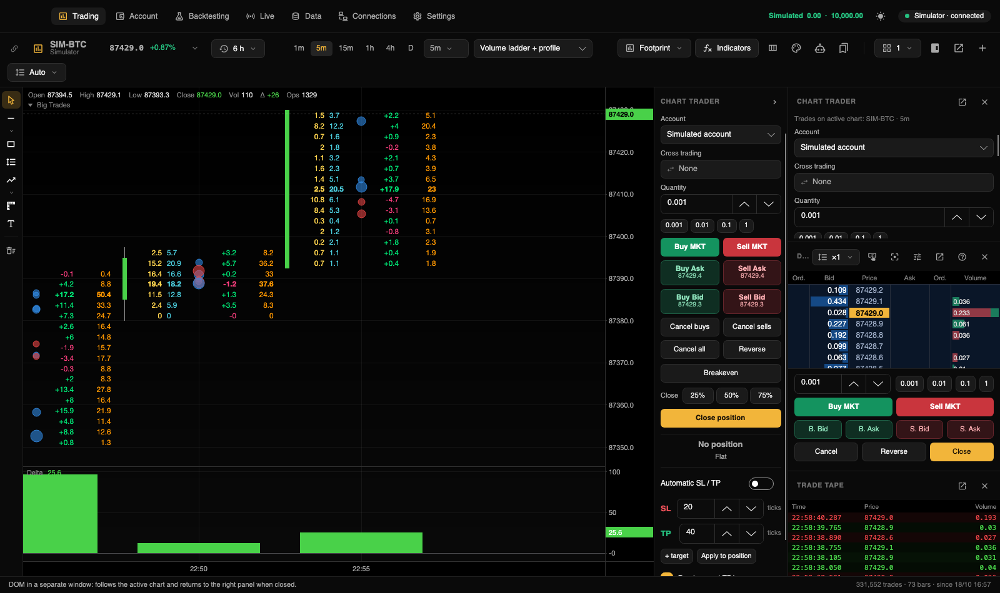

[← Documentation index](README.md)

# Charts

Charts live in **Trading** (⌘1). Each has drawing tools on the left and its own Chart Trader on the right. The top toolbar controls the active chart, meaning the last chart clicked.

## Chart toolbar

| Control | Action |
|---|---|
| Link color | Join a color group; see [Linked charts](#link-charts-by-color). |
| Instrument (⌘K) | Symbol, price and session change; click to select another instrument. |
| History | Choose how much history to load. |
| Periods | Favorite periods and the full period selector. |
| Footprint template / ticks per row | Available in footprint style. |
| Chart style | Candles, Bars, Line, Heikin Ashi or Footprint. |
| Indicators | Open indicator settings (⌘I). |
| Tool icons | Footprint editor, chart settings, chart strategies and templates. |
| Layout | Number and arrangement of charts in this tab. |
| Panels | Show/hide the right panel, Chart Trader, DOM and tape; open DOM settings. |
| Detach / **+** | Detach the chart (⇧⌘D) or create a tab (⌘T). |

The toolbar wraps into two rows in narrower windows.

## Instrument and history

The instrument selector searches enabled connections and displays symbol, description, price, 24-hour change and volume. Enter opens the active chart; ⌘Enter creates a tab; the star marks a favorite.

History ranges run from 30 minutes to five years, plus **All history** and **From a date**. Recent history uses individual trades and supports footprint. Older provider history uses one-minute bars, or five-/15-minute bars for ranges over 400 days; synthetic trades derived from these bars do **not** provide true footprint information. Tick history downloaded through [Data](datos.md) remains tick-level. The status bar indicates where footprint-capable history begins.

## Periods

The defaults are 1m, 5m, 15m, 1h, 4h and D. The selector includes:

| Group | Periods |
|---|---|
| Seconds | 5s, 10s, 15s, 30s. |
| Minutes | 1m, 2m, 3m, 5m, 10m, 15m, 30m. |
| Hours | 1h, 2h, 4h, 6h, 12h. |
| Days | D, W and Month. |
| Ticks | 100, 250, 500 and 1000 trades per bar. |
| Volume | Vol 100, 500 and 1000 units per bar. |
| Range and others | Range 10/20 ticks, Delta 50/100 (close when absolute delta reaches the threshold), Renko 10. |

- **Right-click** a selector period to add/remove its toolbar favorite. Favorites are highlighted.
- **Custom:** enter a code and press Enter, for example `M3`, `H2`, `S20`, `Tick500`, `Volume100`, `Range20`, `Delta75` or `Renko5`.

## Chart styles

Choose **Candles**, **Bars**, **Line**, **Heikin Ashi** or **Footprint**. Switching to footprint increases bar width to make room for numbers.

## Footprint

Footprint adds two controls:

- **Template:** Bid x Ask (classic), Volume ladder + profile, Delta ladder + volume profile, Double ladder (bid | ask), Double delta ladder, Volume (cells), Delta (cells), Bid / ask histogram, Per-bar volume profile and Bid x Ask + profile. User templates have a leading star. **Edit columns** opens the editor.
- **Ticks per row:** Auto, which adapts to zoom, or 1–1000 ticks.

### Footprint editor

Open with ⇧⌘F, the column icon or **Right-click → Edit footprint**. Changes appear immediately.

1. Choose a starting template.
2. Add left-to-right **Ladder**, **Profile**, **Cells**, **Spacer** or **Bar** columns. Arrows reorder and the trash button removes them.
3. Select a column and configure:
   - type: thin candle, colored cells, numerical ladder, histogram profile or spacer;
   - data: volume, delta, bid/aggressive selling, ask/aggressive buying, bid × ask or trade count;
   - relative width, profile direction, strong-delta/diagonal-imbalance/bar-POC/high-volume highlighting, volume/delta/bid-ask/heat-map/solid/no-background coloring, text alignment and numbers over bars;
   - per-column background and text colors; Automatic uses theme defaults.
4. General options include bar totals, POC boxes, imbalance marks, imbalance ratio and minimum volume (default ratio 3), strong-delta threshold, highlight minimum volume and scaling colors per bar versus all visible data.
5. Name and **Save as template** to reuse the layout.

## Navigate a chart

| Gesture | Result |
|---|---|
| Wheel | Horizontal zoom around the pointer. |
| ⇧ + wheel / horizontal gesture | Pan through time. |
| Wheel on price axis / ⌘ + wheel | Vertical zoom. |
| Drag price axis / double-click | Change scale / restore automatic scale. |
| Drag time axis / double-click | Change bar width / return to latest data. |
| Lower-right return button | Appears after scrolling back; returns to latest data. |

See [First steps](primeros-pasos.md#keyboard-shortcuts) for keys. **Chart → Auto scale** is ⌥⌘A; **Latest price** is ⌘End.

## Multiple charts

- Layouts include one chart; two columns or rows; three columns; one large chart with two to the right or below; four (2 × 2); and six (3 × 2). New slots copy the active chart with other periods. Choosing a smaller layout keeps unused charts saved in the tab.
- Each chart in a multi-chart layout has a link-color control, title, maximize/restore, detach and close buttons.
- A detached chart keeps its toolbar, drawings and Chart Trader and can move to another monitor. ⌘W closes it, ⌘I opens indicators and ⌘K opens instrument search. **Return to main window** docks it into a tab.
- The context menu also offers **Move chart to new tab**.

### Link charts by color

Charts in the same red, green, blue, yellow, purple or orange group can share instrument, period and crosshair. The link menu chooses what synchronizes, globally for all groups. Joining a group adopts the instrument and period of its existing members.

## Chart settings

Open the palette icon or **Chart settings** from the context menu. Tabs cover background, candles, axes, price, footprint and trades. They also configure grid, bar data, last-price line, session boundaries and entry/exit line width/style. Each color has a palette, code and opacity; changed colors are marked. **Reset all** restores defaults; **Apply to all charts** copies the appearance.

The context menu controls the **Chart legend**—instrument, OHLC and indicator names—and **Mark my trades**, showing fill triangles and entry-to-exit lines, including previous days.

## Drawings

Tools include cursor (Esc), horizontal line/ray, vertical line, trend line, ray, extended line, rectangle/zone, Fibonacci retracement, long/short position, ruler and text. Group arrows reveal variants. **The final tool deletes all instrument drawings without confirmation.**

- Hold ⇧ to snap a point to a bar's high, low, open or close.
- Drawings are shared by charts of the same instrument and saved automatically.
- Double-click to edit color, width/style, fill, text, extensions, Fibonacci levels, exact prices, visibility, period restriction and locking. Save the style as the default, duplicate or delete the drawing.
- Long/short position tools start with a 1:2 risk/reward stop and target. Entering quantity adds monetary estimates and marks target/stop touches. If both are touched in a bar, the conservative stop outcome is used.

**Price alerts:** right-click a price to create a dotted horizontal alert. Horizontal lines/rays can also enable **Alert when price touches**. Crossing triggers the optional alert sound and a status message, then disables the alert.

## Indicators

The **Indicators** window (⌘I) has three columns:

1. **Library:** search, then double-click or **Add to chart**.
2. **On chart:** show/hide, move between the price panel and a separate panel, or remove.
3. **Settings:** indicator properties and templates—save, apply and choose defaults for newly added instances.

Built-ins include Moving average, Bollinger Bands, VWAP with bands, Volume, Delta, Cumulative delta (CVD), Big Trades, Session volume profile, RSI and MACD. Legend buttons hide, configure or remove an indicator; double-clicking its name opens settings.

Custom C# indicators use **Code → Indicator editor** (⇧⌘E) or the library's code icon. Files in `~/Documents/Trading Hub/Indicadores` recompile on save and appear first under **My indicators**, marked with a star.

## Chart templates

The bookmark icon or context menu lets you:

- save this chart's style, footprint, colors, visibility and indicators—**not** instrument or period;
- apply a saved template;
- choose whether new tabs copy the active chart or use a template;
- delete a template.

## DOM and tape

DOM follows the active chart in the right panel. Default columns show buy orders, bid size, price, ask size, sell orders and session volume. Its header groups prices by ×1–×1000 ticks, toggles execution buttons, centers the ladder, opens settings or detaches it.

**DOM settings** controls columns (including session delta and volume traded at bid/ask), ordering, widths, row height, font, automatic centering, double-click trading, order-book highlight thresholds, bars and colors.

The **trade tape** combines fills from one aggressive order with the same millisecond and side. Wheel scrolling pauses following; click the header to return to the latest trades. See [DOM trading](operar.md#trade-with-dom).

## Volume profile

- **Session volume profile** supports session, weekly or visible-history profiles, volume/delta/bid-ask modes, POC, a default 70% value area and VAH/VAL lines.
- Footprint **Profile** columns display per-bar profiles.

## Replay

[Data → Replay](datos.md#replay) opens stored days in a new tab with speed, pause and seek controls. Trade it with the simulated account.

## Strategies on charts

The robot icon adds a strategy from Backtesting; see [Strategies](estrategias.md). It marks historical and new entries/exits and can remain visual-only or execute in an account. Configure or remove it from the legend.

**Chart history results** below its settings includes:

- net historical PnL using that market's backtest commission and slippage;
- a miniature equity/drawdown curve;
- trade count, win rate, profit factor, drawdown, average trade, average/largest win/loss, streaks, Sharpe, Sortino, recovery, exposure, long/short breakdown, commissions and bars per trade;
- the commission and slippage assumptions used.

These historical results are not a guarantee of live fills or future returns.
