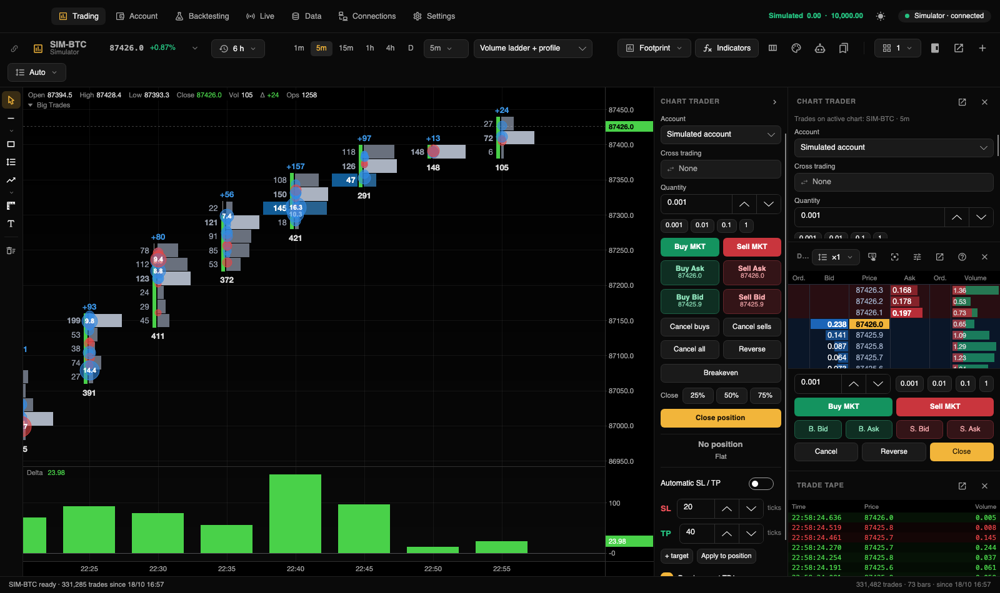

[← Documentation index](./README.md)

# Trading

Place orders in **Trading** using Chart Trader, DOM, the chart context menu or hotkeys. Each chart has its own selected account, initially **Simulated account**.

## Choose an account

Choose **Account** in Chart Trader. The selection is remembered per chart.

| Chart | Available accounts |
|---|---|
| Normal venue chart | Simulated account, plus applicable connected broker accounts below. |
| Binance Futures / Spot | That profile's Binance account, marked testnet or **REAL**. |
| Bybit linear | That profile's one-way UTA account, marked Demo, Testnet or **REAL**. |
| Rithmic futures | Connected Rithmic practice or **REAL** accounts. |
| Rithmic / Tradovate CME futures | Connected Tradovate demo or **REAL** accounts. |
| Composite crypto | No executable account, including the shared simulator. Its composite price is not a venue. |
| Isolated practice replay | Only the replay's own simulated account and balance. No shared simulator or live account. |

Rithmic accounts appear after the order session connects; until then, the ticket explains the wait. Selecting a real account displays an orange **REAL ACCOUNT** warning.

## Chart Trader

It appears on each chart's right edge (collapse with the arrow or ⌥T), and above DOM in the right panel. The right-panel copy follows the active chart; closing a detached copy returns it to the panel.

| Control | Action |
|---|---|
| Account | Select the destination account. |
| Cross trading | Execute in another instrument; see [below](#cross-trading). |
| Quantity | Quick values 1, 2, 5, 10 for whole-unit instruments; fractions for crypto. |
| Buy MKT / Sell MKT | Market order. |
| Buy Ask / Sell Ask | Limit at the displayed ask. Buying crosses immediately with a limit cap; selling waits at the offer. |
| Buy Bid / Sell Bid | Limit at the bid. Buying waits at the bid; selling crosses with a limit cap. |
| Cancel buys / sells | Cancel that side's orders. |
| Cancel all / Reverse | Cancel all orders / reverse position. |
| Breakeven | Move the stop to entry. |
| Close 25% / 50% / 75% | Market partial exit; remaining brackets adjust. |
| Close position | Close at market and cancel orders. |
| PnL / position | Open PnL and long/short quantity/average price, or flat/day PnL. |
| Automatic SL / TP | Stop and target template. |

PnL and position are below the buttons so updates do not shift click targets.

### Order actions on broker accounts

On Binance, Bybit, Rithmic and Tradovate accounts, an order action you confirm (Chart Trader and DOM buttons, hotkeys, chart and DOM drags, stop/target drops, chart-menu bracket actions, and Bybit Cancel/Close in **Accounts**) is handed to that account's order queue and the window keeps responding while the order is recorded on disk and sent. The status bar shows **<action>: pending…** until the account call returns, then its result; if more actions are still queued it adds **· N order action(s) pending**. Actions on one account run one at a time in the order you issued them; confirmations and permission checks happen before the hand-off, exactly as before.

The simulated account, practice replay accounts and live strategies still record their orders on the window's thread, so a slow disk can briefly freeze the window while they do.

## Order types

| Type | Submission | Simulated fill |
|---|---|---|
| Market | MKT, Close, Reverse, partial exits. | Best bid/ask, or last trade when no book exists. |
| Limit | Bid/Ask, DOM, chart context menu. | Price trades through the limit, or subsequent volume at the price exceeds the queue ahead at submission. |
| Stop | DOM beyond current price or chart context menu. | A trade triggers the stop, which then fills at market. |

Protective exits are intended to reduce exposure. The simulator enforces this, and Binance Futures sends its supported native `reduceOnly` payloads. A local reducing flag is **not** exchange enforcement for Binance Spot, Rithmic or Tradovate simple orders; client coordination cannot guarantee that competing exits never reverse a position.

## Trade with DOM

| Gesture | Result |
|---|---|
| Click Bid / buy-order column | Buy limit; at/above ask, buy stop. |
| Click Ask / sell-order column | Sell limit; at/below bid, sell stop. |
| Right-click / ⌥-click | Cancel your orders at that price. |
| Drag your order | Move its price. |
| Wheel / center button | Scroll / recenter the ladder. |

DOM uses the active chart's quantity. **Double-click to trade** disables single-click submission, but cancellation still takes one click. The question-mark control summarizes gestures.

The optional execution strip has quantity shortcuts, Buy/Sell MKT, Buy/Sell Bid/Ask, Cancel, Reverse and Close, all operating on the active chart.

### DOM trading switch

The lock in the DOM header is a separate, saved switch for trading from the DOM; chart trading, Chart Trader and hotkeys are unaffected. It is **on** by default, so the gestures above and the execution strip work exactly as before, behind the same real-account confirmation, real-order permission and risk limits. Turned **off**, the DOM is read-only: clicks, cancel clicks, order drags and the execution strip's order buttons send nothing and open no confirmation, the status bar explains why, and the ladder shows **DOM trading off**. Scrolling, recentering (double-click also recenters while off) and quantity entry still work.

## Trade from the chart

- Right-click below last price for buy-limit/sell-stop; above for sell-limit/buy-stop, using Chart Trader quantity. The menu also cancels all orders.
- Drag an order line to change price.
- Right-click an order to cancel. Targets offer 25/50/75/100% quantity; stops offer breakeven; pending entries can attach the bracket template.
- With a position open, the menu offers half/full market close, breakeven and applying template stops/targets.

## Stops and targets

**Automatic SL / TP** stores a per-instrument template shared by chart and right-panel tickets.

1. Enable it.
2. Set stop distance in ticks from entry.
3. Set target distance. **+ target** adds up to three partial targets with percentages automatically apportioned to 100%; × removes one.
4. **Breakeven at TP1**, enabled by default, moves the stop to entry after the first target fills.

With the template enabled, a new position gets client-coordinated stop/target orders: closing the position requests cancellation of the remaining protection. Pending limit/stop entries carry attachments until explicit fills arrive. Increasing a position extends protection; partial exits resize it. Delayed acceptance/cancellation remains owned, both account snapshots must be ready, and a disappearing or rejected target does not count as a target fill or trigger breakeven.

**Apply to position** replaces the current position's stop/targets with the template. You can also drag SL/TP handles from a position or pending entry, or drag from the position line toward profit for a target and toward loss for a stop.

By default every connection's protection is **app-managed**: the stop and targets are separate working orders, and Trading Hub cancels the remaining ones and resizes them. Safe native amendments or sequenced replacements retain one tracked handle and wait for actual working-state acknowledgment; an optimistic price/quantity update is not confirmation. Unknown placement replies are reconciled by exact client identity instead of blindly retried. Sibling cancellation, trailing and resizing require the application and connection to remain operational; broker orders left after Quit have no app-managed OCO protection.

### Exchange-side protection

A Tradovate connection can opt in to **Exchange-side protection (Tradovate OCO)** under **Connections → Tradovate → Stops and targets**. It is off by default. When it is on and the position's protection is exactly one stop and one target, each for the whole position, both are sent in one [`placeOCO`](https://partner.tradovate.com/api/rest-api-endpoints/orders/place-oco) request. When one fills, Tradovate cancels the other even if Trading Hub is closed or disconnected. Chart Trader shows **Exchange-side protection** once Tradovate reports both legs in one OCO group, and **App-managed protection** otherwise. Automatic SL/TP, Chart Trader brackets and a live strategy's stop loss and take profit use it.

- Each leg keeps its own client order ID, saved ownership and acknowledgment rules. An unknown reply is reconciled from those IDs and never sent again.
- Moving a leg is a native amendment of that leg. Position increases and partial exits resize the legs natively while Trading Hub runs.
- Partial targets, a stop without a target, or a target that does not cover the whole position stay app-managed. Chart Trader says why.
- If Tradovate refuses the OCO, both legs are sent again as separate app-managed orders and the reason stays visible. Linking stays off for that session until the option is switched off and on again.
- If Tradovate cancels a leg that Trading Hub never asked to cancel, Trading Hub waits for the cause, because cancellation, fill and position reports arrive separately and in any order. Chart Trader shows a **Protection gap** while it waits.
  - The leg is replaced with an app-managed order only for a confirmed cause:
    - the other leg executed, partly or completely, after the cancelled leg was last sized; or
    - Trading Hub cancelled the other leg (bracket removal, the DOM or the order list) and that cancellation has ended.

    The replacement is sent only once those fills are booked, the reported position has fallen by them, and Tradovate's timestamp on that position report is no earlier than the other leg's last fill. Until then, an older position report can neither confirm nor size it. It is sized from the reported position, including reductions made outside the brackets.
  - The wait ends without sending anything when the position is flat.
  - Legs that Trading Hub itself asked to cancel (including **Cancel all** and **Close position**) are never replaced. When both legs were cancelled and nobody here requested either, the cancellation is respected as for app-managed orders.
  - Setting a stop or moving it to breakeven yourself ends the wait: that stop is placed at once as app-managed protection. The automatic breakeven after the first target only changes the price the waiting stop will use. Removing protection or applying the template during the wait discards the cancelled leg; it is never revived.
  - A position report proves nothing about executions whose fill reports are missing or undated. Working stops (or targets) never add up to more than the position.
  - After 30 seconds, a leg whose cause was confirmed but whose position check never passed is placed anyway, sized from the booked fills and the reported position. Without a confirmed cause, Chart Trader keeps showing the **Protection gap** and that no stop (or target) is working. Nothing is sent automatically, so place a new stop yourself.
- A strategy's linked pair and the chart's are separate: one owner's order is never paired with another's.
- After a restart, chart protection that is still working at Tradovate is re-owned from the saved client IDs and adopted. It is never placed a second time. A strategy re-adopts its own kept stop and target as before.

Tradovate documents neither reduce-only orders nor how OCO legs follow partial fills or a cancellation of one leg. While Trading Hub is closed, a leg that is larger than the remaining position is not resized, and a cancelled leg is not replaced. While it runs, a replacement waits for the position report, so a short gap with a visible status is possible. These behaviours are verified against a fake venue that publishes cancellation, fill and position reports separately; follow the [demo checklist](./native-protection-demo-checklist.md) before relying on them with real money.

Binance, Bybit and Rithmic connections stay app-managed. Their documented linked contracts do not fit these ownership and resizing rules; the [checklist](./native-protection-demo-checklist.md#venues-that-stay-app-managed) records why.

Verify authorized demo-account behavior before relying on real trading.

## Cross trading

View one instrument and execute in another—for example ES → MES. **Cross trading** searches instruments, prioritizing the same underlying; **None** restores execution in the displayed instrument. Orders, stops and targets use the selected instrument **at the same numerical prices**, not a conversion. A warning appears when the instruments' prices differ.

## Trading shortcuts

Under **Settings → Keyboard shortcuts → Trading**, assign buy/sell market, buy bid, sell ask, close, reverse, cancel all, 25%/50% exits, breakeven, bracket application and next/previous quick quantity. They are unassigned by default.

Bindings target the active chart. Plain keys do not fire while typing in a text field; modified ⌘/⌥/⌃ or function-key bindings can still fire. Choose them carefully.

## Accounts section

**Accounts** (⌘5) displays one account at a time, selected from groups for simulation, Rithmic and Tradovate.

Cards show Balance, Today's PnL, Open PnL, Realized today, Total PnL for simulation or Available to trade for broker accounts, and Active orders. Broker balances come from Rithmic/Tradovate rather than an app-generated balance estimate.

| Tab | Contents |
|---|---|
| Positions | Contract, side, quantity, average price, open/realized PnL and Close. |
| Orders | Today's active/completed orders, status and Cancel. |
| Fills | Time, contract, side, quantity, price and commission. |
| Trades | Closed round trips with entry, exit, duration and PnL. |
| Statistics | Today, seven days, 30 days or all: equity, net PnL, win rate, profit factor, maximum drawdown, expectancy, streaks, long/short and daily results. |

Position/order rows remain in place; new rows append, reducing accidental clicks on adjacent rows. Local history survives app closure.

For simulation, change **Initial balance** or **Reset simulated account**. Reset starts fresh history at the initial balance and archives the old records. Positions and active orders must first be cleared.

## Safety

- **No real trading by default.** Each profile's real-order permission starts disabled. Without it, the real account is unavailable for submission; see [Connections](./conexiones.md#real-and-test-accounts).
- **Permission is checked when an order is sent.** Disabling a connection or its real orders takes effect immediately, including for charts, Chart Trader and live strategies that still use the account: an order that would open, add to or reverse a position is blocked with an **Order blocked** message (strategies log it and keep managing their exits). Cancels and orders that only reduce a position (close, partial exit, stop/target moves) stay available behind the usual confirmation.
- **No confirmation on test accounts.** Simulation, demo, practice and testnet clicks submit immediately.
- **Real-order confirmation.** By default a **Confirm REAL order** dialog identifies action and account. This also covers changes, closes, reversals, cancellations, partial exits and breakeven through manual controls. To disable it where supported, both the profile's per-real-order confirmation and **Settings → Trading → Confirm real orders** must be off. Tradovate has no profile switch for bypassing this, so its real orders still require confirmation. Accounts Close/Cancel also confirm for real accounts.
- **Dangerous confirmations default to Cancel.** Dialogs for real-money execution, Stop all and close, deletions, closing positions and the paid Databento download preselect **Cancel**: Enter and Esc cancel, and only a click or ⌘Enter confirms. Ordinary confirmations keep their action as the default.
- **Maximum order size.** Real orders larger than the configured connection limit are blocked with an **Order blocked** message.
- **Strategy limits.** Automatic strategies have daily-loss and drawdown limits; **0 means no limit**. **Live → Stop all** stops strategies, cancels their orders and requests closure of their positions. Confirm resulting broker positions; network failures can prevent closure.
- **Quitting asks first.** While live strategies hold positions, ⌘Q and **Quit Trading Hub** show the same **Quit Trading Hub** dialog: keep their stop loss and take profit working at the broker (the default), cancel them, close the positions (never by Enter) or don't quit (Esc). Quitting never closes positions unless you choose that. Details are in Live strategies, under Closing the window and reopening.
- **Queued order actions finish before quitting.** After you quit, order actions already handed to a broker account's queue are recorded and sent before strategies stop or connections close; an order action issued after that is refused with **Trading Hub is quitting: the order action was not sent.**
- **Visible real-account warnings.** Real destinations are marked orange with **REAL** / **REAL ACCOUNT**.

A launch confirmation authorizes an automatic strategy to trade without an individual dialog for every generated order. Start with simulation; a translated interface is not a guarantee of trading safety.
