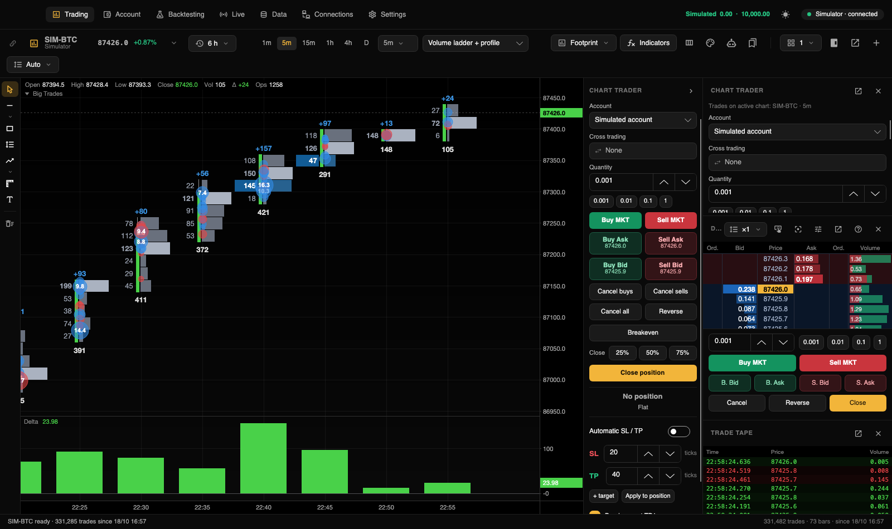

[← Documentation index](README.md)

# Trading

Place orders in **Trading** using Chart Trader, DOM, the chart context menu or hotkeys. Each chart has its own selected account, initially **Simulated account**.

## Choose an account

Choose **Account** in Chart Trader. The selection is remembered per chart.

| Chart | Available accounts |
|---|---|
| Any | Simulated account. |
| Binance Futures / Spot | That profile's Binance account, marked testnet or **REAL**. |
| Rithmic futures | Connected Rithmic practice or **REAL** accounts. |
| Rithmic / Tradovate CME futures | Connected Tradovate demo or **REAL** accounts. |

Rithmic accounts appear after the order session connects; until then, the ticket explains the wait. Selecting a real account displays an orange **REAL ACCOUNT** warning.

## Chart Trader

It appears on each chart's right edge (collapse with the arrow or ⌥T), and above DOM in the right panel. The right-panel copy follows the active chart; closing a detached copy returns it to the panel.

| Control | Action |
|---|---|
| Account | Select the destination account. |
| Cross trading | Execute in another instrument; see [below](#cross-trading). |
| Quantity | Quick values 1, 2, 5, 10 for whole-unit instruments; fractions for crypto. |
| Buy MKT / Sell MKT | Market order. |
| Buy Ask / Sell Ask | Limit at the displayed ask. Buying crosses immediately with a limit cap; selling waits at the offer. |
| Buy Bid / Sell Bid | Limit at the bid. Buying waits at the bid; selling crosses with a limit cap. |
| Cancel buys / sells | Cancel that side's orders. |
| Cancel all / Reverse | Cancel all orders / reverse position. |
| Breakeven | Move the stop to entry. |
| Close 25% / 50% / 75% | Market partial exit; remaining brackets adjust. |
| Close position | Close at market and cancel orders. |
| PnL / position | Open PnL and long/short quantity/average price, or flat/day PnL. |
| Automatic SL / TP | Stop and target template. |

PnL and position are below the buttons so updates do not shift click targets.

## Order types

| Type | Submission | Simulated fill |
|---|---|---|
| Market | MKT, Close, Reverse, partial exits. | Best bid/ask, or last trade when no book exists. |
| Limit | Bid/Ask, DOM, chart context menu. | Price trades through the limit, or subsequent volume at the price exceeds the queue ahead at submission. |
| Stop | DOM beyond current price or chart context menu. | A trade triggers the stop, which then fills at market. |

Protective stops and targets are reduce-only: they must not reverse a position.

## Trade with DOM

| Gesture | Result |
|---|---|
| Click Bid / buy-order column | Buy limit; at/above ask, buy stop. |
| Click Ask / sell-order column | Sell limit; at/below bid, sell stop. |
| Right-click / ⌥-click | Cancel your orders at that price. |
| Drag your order | Move its price. |
| Wheel / center button | Scroll / recenter the ladder. |

DOM uses the active chart's quantity. **Double-click to trade** disables single-click submission, but cancellation still takes one click. The question-mark control summarizes gestures.

The optional execution strip has quantity shortcuts, Buy/Sell MKT, Buy/Sell Bid/Ask, Cancel, Reverse and Close, all operating on the active chart.

## Trade from the chart

- Right-click below last price for buy-limit/sell-stop; above for sell-limit/buy-stop, using Chart Trader quantity. The menu also cancels all orders.
- Drag an order line to change price.
- Right-click an order to cancel. Targets offer 25/50/75/100% quantity; stops offer breakeven; pending entries can attach the bracket template.
- With a position open, the menu offers half/full market close, breakeven and applying template stops/targets.

## Stops and targets

**Automatic SL / TP** stores a per-instrument template shared by chart and right-panel tickets.

1. Enable it.
2. Set stop distance in ticks from entry.
3. Set target distance. **+ target** adds up to three partial targets with percentages automatically apportioned to 100%; × removes one.
4. **Breakeven at TP1**, enabled by default, moves the stop to entry after the first target fills.

With the template enabled, a new position gets OCO protective orders: closing the position cancels remaining protective orders. Pending limit/stop entries carry attachments until filled. Increasing a position extends protection; partial exits resize it.

**Apply to position** replaces the current position's stop/targets with the template. You can also drag SL/TP handles from a position or pending entry, or drag from the position line toward profit for a target and toward loss for a stop.

Do not assume all strategy/OCO management is broker-native. App-managed protection requires the application and connection to remain operational; verify provider behavior before real trading.

## Cross trading

View one instrument and execute in another—for example ES → MES. **Cross trading** searches instruments, prioritizing the same underlying; **None** restores execution in the displayed instrument. Orders, stops and targets use the selected instrument **at the same numerical prices**, not a conversion. A warning appears when the instruments' prices differ.

## Trading shortcuts

Under **Settings → Keyboard shortcuts → Trading**, assign buy/sell market, buy bid, sell ask, close, reverse, cancel all, 25%/50% exits, breakeven, bracket application and next/previous quick quantity. They are unassigned by default.

Bindings target the active chart. Plain keys do not fire while typing in a text field; modified ⌘/⌥/⌃ or function-key bindings can still fire. Choose them carefully.

## Accounts section

**Accounts** (⌘5) displays one account at a time, selected from groups for simulation, Rithmic and Tradovate.

Cards show Balance, Today's PnL, Open PnL, Realized today, Total PnL for simulation or Available to trade for broker accounts, and Active orders. Broker balances come from Rithmic/Tradovate rather than an app-generated balance estimate.

| Tab | Contents |
|---|---|
| Positions | Contract, side, quantity, average price, open/realized PnL and Close. |
| Orders | Today's active/completed orders, status and Cancel. |
| Fills | Time, contract, side, quantity, price and commission. |
| Trades | Closed round trips with entry, exit, duration and PnL. |
| Statistics | Today, seven days, 30 days or all: equity, net PnL, win rate, profit factor, maximum drawdown, expectancy, streaks, long/short and daily results. |

Position/order rows remain in place; new rows append, reducing accidental clicks on adjacent rows. Local history survives app closure.

For simulation, change **Initial balance** or **Reset simulated account**. Reset starts fresh history at the initial balance and archives the old records. Positions and active orders must first be cleared.

## Safety

- **No real trading by default.** Each profile's real-order permission starts disabled. Without it, the real account is unavailable for submission; see [Connections](conexiones.md#real-and-test-accounts).
- **Permission is checked when an order is sent.** Disabling a connection or its real orders takes effect immediately, including for charts, Chart Trader and live strategies that still use the account: an order that would open, add to or reverse a position is blocked with an **Order blocked** message (strategies log it and keep managing their exits). Cancels and orders that only reduce a position (close, partial exit, stop/target moves) stay available behind the usual confirmation.
- **No confirmation on test accounts.** Simulation, demo, practice and testnet clicks submit immediately.
- **Real-order confirmation.** By default a **Confirm REAL order** dialog identifies action and account. This also covers changes, closes, reversals, cancellations, partial exits and breakeven through manual controls. To disable it where supported, both the profile's per-real-order confirmation and **Settings → Trading → Confirm real orders** must be off. Tradovate has no profile switch for bypassing this, so its real orders still require confirmation. Accounts Close/Cancel also confirm for real accounts.
- **Dangerous confirmations default to Cancel.** Dialogs for real-money execution, Stop all and close, deletions, closing positions and the paid Databento download preselect **Cancel**: Enter and Esc cancel, and only a click or ⌘Enter confirms. Ordinary confirmations keep their action as the default.
- **Maximum order size.** Real orders larger than the configured connection limit are blocked with an **Order blocked** message.
- **Strategy limits.** Automatic strategies have daily-loss and drawdown limits; **0 means no limit**. **Live → Stop all** stops strategies, cancels their orders and requests closure of their positions. Confirm resulting broker positions; network failures can prevent closure.
- **Quitting asks first.** While live strategies hold positions, ⌘Q and **Quit Trading Hub** show the same **Quit Trading Hub** dialog: keep their stop loss and take profit working at the broker (the default), cancel them, close the positions (never by Enter) or don't quit (Esc). Quitting never closes positions unless you choose that. Details are in Live strategies, under Closing the window and reopening.
- **Visible real-account warnings.** Real destinations are marked orange with **REAL** / **REAL ACCOUNT**.

A launch confirmation authorizes an automatic strategy to trade without an individual dialog for every generated order. Start with simulation; a translated interface is not a guarantee of trading safety.
