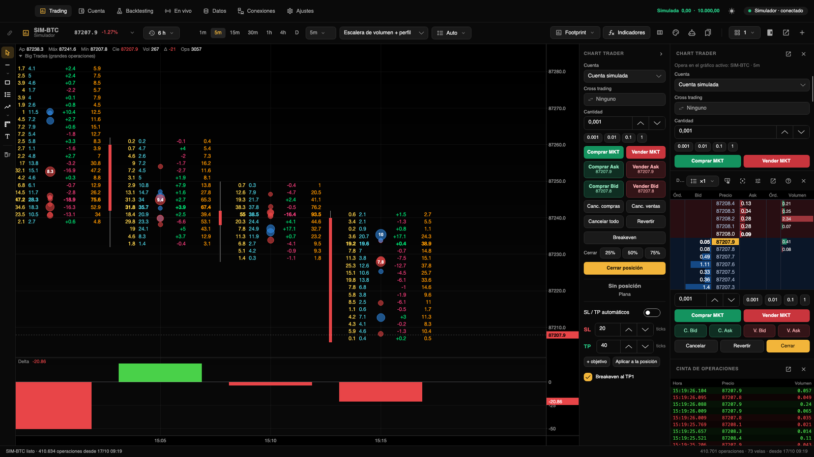

[← Volver al índice](./README.md)

# Gráficos

Todo esto pasa en la sección **Trading** (⌘1). Cada gráfico tiene su barra de dibujos a la izquierda y su Chart
Trader a la derecha; la barra de arriba actúa sobre el gráfico activo (el último en el que hiciste clic).

## La barra del gráfico

| Control | Qué hace |
|---|---|
| Color de vinculación | Une el gráfico a un grupo de color (ver [Vincular gráficos](#vincular-gráficos-por-color)). |
| Instrumento (⌘K) | Muestra el símbolo, el precio y la variación desde el inicio de la sesión. Clic para elegir otro. |
| Historia | Cuánta historia cargar. |
| Períodos | Los favoritos a la vista y un selector con todos. |
| Plantilla de footprint y ticks por fila | Solo en modo footprint. |
| Tipo de gráfico | Velas, Barras, Línea, Heikin Ashi o Footprint. |
| Indicadores | Abre la ventana de indicadores (⌘I). |
| Íconos | Editar footprint, Configuración del gráfico, Estrategias en el gráfico y Plantillas de gráfico. |
| Diseño | Cuántos gráficos ver en la pestaña. |
| Paneles | Muestra u oculta el panel derecho, el Chart Trader, el DOM y la cinta; también abre «Configurar DOM…». |
| Ventana aparte y **+** | Saca el gráfico a una ventana (⇧⌘D) o abre una pestaña nueva (⌘T). |

Si la ventana es angosta, la barra se acomoda en dos líneas.

## Instrumento e historia

El selector de instrumento busca en las conexiones activas, con columnas de símbolo, descripción, precio, variación
de 24 horas y volumen. Enter abre en el gráfico activo y ⌘Enter en una pestaña nueva; la estrella marca favoritos.

El botón de historia ofrece desde 30 minutos hasta 5 años, «Todo el historial» y «Desde una fecha…». Lo reciente se
carga tick a tick, con footprint. Lo más viejo llega en velas de la conexión (de 1 minuto; en rangos de más de 400
días, de 5 o 15 minutos) y esas velas no tienen footprint. Lo que bajaste en [Datos](./datos.md) se usa tick a tick.
Al terminar, la barra de estado dice desde cuándo hay footprint.

## Períodos

Los períodos favoritos están en la barra (de fábrica: 1m, 5m, 15m, 1h, 4h y D). El selector de al lado tiene todos:

| Grupo | Períodos |
|---|---|
| Segundos | 5s, 10s, 15s, 30s |
| Minutos | 1m, 2m, 3m, 5m, 10m, 15m, 30m |
| Horas | 1h, 2h, 4h, 6h, 12h |
| Días | D (diario), S (semanal), Mes |
| Ticks | 100, 250, 500 y 1000 ticks: cada vela tiene esa cantidad de operaciones |
| Volumen | Vol 100, 500 y 1000: cada vela junta ese volumen |
| Rango y otros | Rango 10 y 20 (velas de N ticks de rango), Delta 50 y 100 (la vela cierra cuando el delta llega a N), Renko 10 |

- **Clic derecho** sobre un período del selector lo pone o lo saca de la barra. Los que están en la barra se ven en
  color.
- **A medida**: escribí un código en el campo de abajo y tocá Enter. Ejemplos: `M3`, `H2`, `S20`, `Tick500`,
  `Volume100`, `Range20`, `Delta75`, `Renko5`.

## Tipos de gráfico

**Velas**, **Barras**, **Línea**, **Heikin Ashi** y **Footprint**. Al pasar a footprint, las velas se ensanchan para
que entren los números.

## Footprint

En modo footprint aparecen dos controles más en la barra:

- **Plantilla de footprint**: cómo se arma cada vela. Trae «Bid x Ask (clásico)», «Escalera de volumen + perfil»,
  «Escalera de delta + perfil de volumen», «Doble escalera (bid | ask)», «Doble escalera de delta», «Volumen
  (celdas)», «Delta (celdas)», «Histograma bid / ask», «Perfil de volumen por vela» y «Bid x Ask + perfil». Las tuyas
  aparecen con una estrella adelante. La última opción, «Editar columnas…», abre el editor.
- **Ticks por fila**: Auto (se adapta al zoom) o de 1 a 1000 ticks.

### Editor de footprint

Se abre con ⇧⌘F, con el ícono de columnas de la barra o desde el clic derecho («Editar footprint…»). Los cambios se
ven en el gráfico al momento.

1. Elegí una base en **Partir de una plantilla**.
2. En **Columnas** (de izquierda a derecha dentro de cada vela), agregá piezas con los botones Escalera, Perfil,
   Celdas, Espacio y el de la vela, que agrega una «Vela finita». Ordenalas con las flechas y quitalas con el tacho.
3. Elegí una columna y ajustala a la derecha:
   - **Tipo**: Vela finita, Celdas coloreadas, Escalera (números), Perfil (histograma) o Espacio.
   - **Dato**: Volumen, Delta, Bid (ventas agresivas), Ask (compras agresivas), Bid x Ask u Operaciones.
   - **Ancho** relativo, **Dirección de las barras** (en los perfiles), **Resaltar** (delta fuerte, desequilibrios
     diagonales, POC de la vela o volumen alto), **Colores de las celdas** (proporcional al volumen, por delta,
     bid / ask, mapa de calor, sólido o sin fondo), alineación del texto y números sobre las barras.
   - **Colores de fondo** y **Colores del texto** propios de esa columna (automático = los del tema).
4. En **Opciones generales**: totales de cada vela, recuadro en el POC, marcar desequilibrios, proporción y volumen
   mínimo del desequilibrio (3 veces por defecto), umbral de delta fuerte, volumen mínimo para resaltar y si los
   colores son proporcionales a cada vela o a todo lo visible.
5. Poné un **Nombre de la plantilla** y tocá **Guardar como plantilla** para usarla en otros gráficos.

## Moverse por el gráfico

| Acción | Resultado |
|---|---|
| Rueda | Zoom horizontal alrededor del mouse |
| ⇧ + rueda, o deslizar de costado | Desplaza en el tiempo |
| Rueda sobre el eje de precios, o ⌘ + rueda | Zoom vertical |
| Arrastrar el eje de precios / doble clic | Cambia la escala / vuelve a la escala automática |
| Arrastrar el eje de tiempo / doble clic | Cambia el ancho de las velas / vuelve a lo último |
| Botón de abajo a la derecha | Aparece si te corriste hacia atrás: vuelve a lo último |

También sirven las teclas de [Primeros pasos](./primeros-pasos.md#atajos-de-teclado) y, en el menú Gráfico,
«Escala automática» (⌥⌘A) e «Ir al último precio» (⌘Fin).

## Varios gráficos

- **Diseños**: un gráfico, dos (lado a lado o uno arriba del otro), tres en columnas, uno grande y dos a la derecha,
  uno grande arriba y dos abajo, cuatro (2 × 2) o seis (3 × 2). Los lugares nuevos se llenan con copias del gráfico
  activo en otros períodos. Si elegís un diseño más chico, los que sobran quedan guardados en la pestaña.
- Con varios gráficos, cada uno tiene una barrita con su color de vinculación, el título y botones para **agrandarlo**
  (ocupa toda la pestaña hasta que lo achicás), **sacarlo a una ventana aparte** y **cerrarlo**.
- **Ventanas aparte**: el gráfico se va con su barra propia, sus dibujos y su Chart Trader, y lo podés llevar a otro
  monitor. Dentro de esa ventana, ⌘W la cierra, ⌘I abre indicadores y ⌘K el buscador. «Volver a la ventana principal»
  lo devuelve a una pestaña.
- El clic derecho ofrece además «Pasar este gráfico a una pestaña nueva».

### Vincular gráficos por color

Los gráficos con el mismo color (rojo, verde, azul, amarillo, violeta o naranja) comparten el instrumento, el período y
la cruz del cursor. En el menú del color elegís qué se sincroniza; vale para todos los grupos. Al entrar a un grupo, el
gráfico toma el instrumento y el período de los que ya estaban.

## Configuración del gráfico

El ícono de la paleta (o «Configuración del gráfico…» en el clic derecho) abre los colores de ese gráfico, en
pestañas: **Fondo**, **Velas**, **Ejes**, **Precio**, **Footprint** y **Operaciones**. También están ahí la cuadrícula,
los datos de la vela, la línea del último precio, el inicio de cada sesión y el grosor y trazo de las líneas de
entrada a salida. Cada color tiene paleta, código y opacidad; un punto marca los que cambiaste. «Restablecer todo»
vuelve a los de siempre y «Aplicar a todos los gráficos» copia el aspecto a los demás.

Desde el clic derecho también controlás la **Leyenda del gráfico** (nombre del instrumento, valores de la vela y
nombres de los indicadores) y **Marcar mis operaciones**: un triángulo en cada ejecución y una línea de la entrada a
la salida de cada operación, también de días anteriores.

## Dibujos

La barra de la izquierda tiene: cursor (Esc), líneas (horizontal, rayo horizontal, vertical, de tendencia, rayo y
extendida), rectángulo o zona, retroceso de Fibonacci, posición larga o corta, regla y texto. La flechita debajo de un
grupo muestra sus variantes. El último botón borra todos los dibujos del instrumento, sin preguntar.

- Con ⇧ apretado, el punto se pega al máximo, mínimo, apertura o cierre de la vela.
- Los dibujos se ven en todos los gráficos del mismo instrumento y se guardan solos.
- **Doble clic** sobre un dibujo abre su panel: línea (color, grosor, estilo), relleno, texto, extender, niveles de
  Fibonacci, precios exactos y visibilidad (ocultar, mostrar solo en un período, bloquear). «Usar como
  predeterminado» guarda el estilo para los próximos de ese tipo; también hay «Duplicar» y «Eliminar».
- La **posición larga o corta** arranca con stop y objetivo 1:2; con una cantidad cargada muestra cuánto ganarías o
  perderías y marca si las velas tocan el objetivo o el stop.

**Alertas de precio**: clic derecho → «Alerta de precio en…» crea una línea horizontal punteada. En una línea
horizontal o un rayo horizontal podés activar «Alertar cuando el precio toque». Cuando el precio la cruza, suena (si
los sonidos de alerta están activados en Ajustes), avisa en la barra de estado y la alerta se apaga.

## Indicadores

La ventana de **Indicadores** (⌘I) tiene tres columnas:

1. **Biblioteca**, con buscador. Para agregar uno, elegilo y tocá «Agregar al gráfico» o hacé doble clic.
2. **En el gráfico**: mostrar u ocultar, pasar entre el gráfico de precio y un panel propio, y quitar.
3. **Configuración** del indicador elegido, con **Plantillas**: guardar sus ajustes, aplicar una guardada y elegir con
   cuál arrancan los nuevos.

Incluidos: Media móvil, Bandas de Bollinger, VWAP con desvíos, Volumen, Delta, Delta acumulado (CVD), Big Trades
(grandes operaciones), Perfil de volumen por sesión, RSI y MACD. En la leyenda del gráfico cada indicador tiene botones
para ocultarlo, abrir sus ajustes y quitarlo; doble clic en el nombre también abre sus ajustes.

Tus propios indicadores en C# se escriben en **Código → Editor de indicadores…** (⇧⌘E) o con el ícono de llaves de la
biblioteca. Viven en `~/Documents/Trading Hub/Indicadores`, se compilan solos al guardar y aparecen primero, en el
grupo «Mis indicadores» (marcado con una estrella).

## Plantillas de gráfico

El ícono de marcadores (o «Plantillas de gráfico» en el clic derecho) permite:

- **Guardar este gráfico como plantilla…**: guarda el estilo, el footprint, los colores, lo que se muestra y los
  indicadores; no el instrumento ni el período.
- Aplicar una plantilla al gráfico.
- **Para las pestañas nuevas**: copiar el gráfico activo o arrancar con una plantilla.
- **Borrar una plantilla**.

## DOM y cinta

El **DOM** está en el panel derecho y sigue al gráfico activo. De fábrica muestra órdenes de compra, bid, precio, ask,
órdenes de venta y volumen de la sesión. En su encabezado podés agrupar precios (×1 a ×1000 ticks), mostrar los botones
de ejecución, centrar en el precio, configurarlo y sacarlo a una ventana. **Configurar DOM** elige columnas (también
delta de la sesión y lo operado al bid y al ask), su orden y su ancho, el alto de fila, la letra, el centrado
automático, «Doble clic para operar», el tamaño desde el que se resalta el libro, las barras del libro y los colores.

La **Cinta de operaciones** lista las operaciones a medida que llegan; las ejecuciones de una misma orden agresiva
(mismo milisegundo y lado) se suman en una fila. Con la rueda vas hacia atrás y la lista se queda quieta; un clic en
el encabezado vuelve a lo último. Cómo se opera con el DOM está en [Operar](./operar.md#operar-con-el-dom).

## Perfil de volumen

- El indicador **Perfil de volumen por sesión** dibuja el perfil por sesión, por semana o de toda la historia visible,
  de volumen, delta o bid / ask, con POC, área de valor (70 % por defecto) y líneas VAH / VAL.
- En el footprint, las columnas de tipo **Perfil** muestran el perfil de cada vela.

## Replay

Desde [Datos](./datos.md#replay) podés reproducir días guardados en una pestaña nueva, con velocidad, pausa y saltos, y
operar con la cuenta simulada como si fuera en vivo.

## Estrategias en el gráfico

El ícono del robot pone en el gráfico una estrategia de las que tenés en Backtesting (cómo se escriben, en
[Estrategias](./estrategias.md)). Marca dónde entra y sale, sobre la historia y en vivo, y puede quedarse solo como marca
visual o ejecutar en una cuenta. Se configura o se quita desde la leyenda del gráfico.

Abajo de la configuración, **En la historia del gráfico** muestra cómo le fue en lo que tiene cargado el gráfico:

- **El resultado real, grande.** Se calcula con la comisión y el deslizamiento de ese mercado, los mismos del
  backtest.
- **Una mini curva de capital** con su drawdown.
- **Las estadísticas:** operaciones, % ganadoras, profit factor, drawdown, promedio por operación, ganancia y pérdida
  media, la mayor ganancia y la mayor pérdida, rachas, Sharpe, Sortino, recuperación, exposición, largos y cortos,
  comisiones y velas por operación.
- **Qué comisión y deslizamiento se usaron.**
